# 师砺平台用户操作手册

> 适用版本：V1.0.1.8　｜　适用对象：平台管理员、学校教务管理员、教师、学生
>
> 本手册的截图来自测试环境，其中的人名、班级、课程都是演示数据。你在学校系统里看到的数据会不一样，但页面和按钮是相同的。

---

## 目录

- [第一章 写在前面：人人都要看](#第一章-写在前面人人都要看)
  - [1.1 平台是做什么的](#11-平台是做什么的)
  - [1.2 几个常用词](#12-几个常用词)
  - [1.3 登录与首次修改密码](#13-登录与首次修改密码)
  - [1.4 认识界面](#14-认识界面)
  - [1.5 通知、个人中心与深色模式](#15-通知个人中心与深色模式)
- [第二章 管理员篇](#第二章-管理员篇)
- [第三章 教师篇](#第三章-教师篇)
- [第四章 学生篇](#第四章-学生篇)
- [第五章 常见问题](#第五章-常见问题)
- [附录 各角色能做什么](#附录-各角色能做什么)

---

## 第一章 写在前面：人人都要看

### 1.1 平台是做什么的

师砺平台是一个**实训教学平台**。一句话概括：

> 管理员把班级、老师、学生和学期准备好 → 老师建课程、发布实训任务、批改 → 学生提交任务、看反馈、看自己的能力成长。

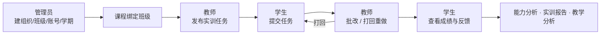

### 1.2 几个常用词

先认识下面这些词，后面读起来会轻松很多。

| 词 | 意思 |
| --- | --- |
| **实训课程** | 一门课，例如“教师书写技能实训”。课程下面有班级、实训任务和课程资源。 |
| **专属实训 / 公共课** | 专属实训只有建课老师和助教能用；公共课需要学校教务管理员审批，通过后所有老师都能查看并给自己的班级布置任务。 |
| **班级课程（班课）** | 某个班级在某个学期上某门课程。只有课程“添加了班级”之后，才能给这个班发布任务。 |
| **实训任务** | 老师布置给学生的一项练习或作业。分为**平时任务**和**考核任务**，等级分为**初级、中级、高级**。 |
| **等级解锁** | 同一门课里，学生要先把上一等级的任务做到一定达标比例（默认 80%），才能做下一等级的任务。 |
| **打回重做** | 老师认为提交不合格时，可以退回给学生修改，并给出重做截止时间。 |
| **能力指标** | 学校设定的能力评价体系，分一级指标（如“书写技能”）和二级指标（如“粉笔字”）。任务挂上指标后，成绩会计入学生的能力分析。 |
| **达标** | 成绩达到任务的及格分数线（默认 60 分）。 |
| **归档** | 把不再使用的班级、课程或任务“收起来”。归档不会删除数据，打开“显示已归档”可以找回并恢复。 |

### 1.3 登录与首次修改密码

1. 在浏览器中打开学校提供的平台地址（推荐使用 Chrome 或 Edge 浏览器）。
2. 输入**账号**和**密码**，点击 **登录**。
   - 学生的账号一般是**学号**，教师的账号一般是**工号**。
   - 勾选“记住账号”，下次登录时就不用再输入账号了。

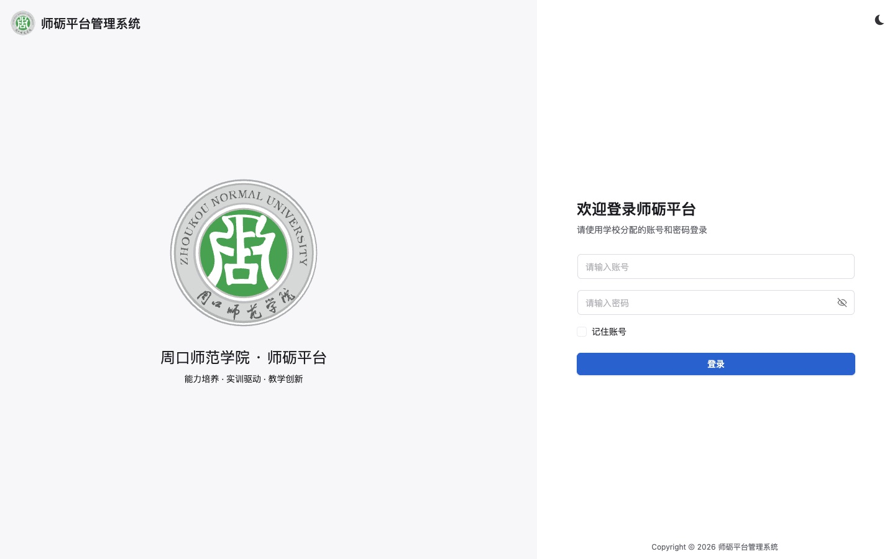

**第一次登录（学生）**：系统会先要求修改初始密码。输入旧密码（也就是管理员告诉你的初始密码）和两次新密码，点击 **修改密码**，然后用新密码重新登录。如果想换一个账号，点页面下方的 **返回登录**。

新密码的要求：

- 长度 **8～16 位**；
- **同时包含字母和数字**；
- 不能和账号相同，也不能和旧密码相同。

> 💡 忘记密码怎么办？平台没有自助找回功能。请联系管理员在“学生管理 / 教师管理”里帮你**重置密码**。

### 1.4 认识界面

平台有两种界面布局。

**① 管理员和教师：左侧菜单布局**

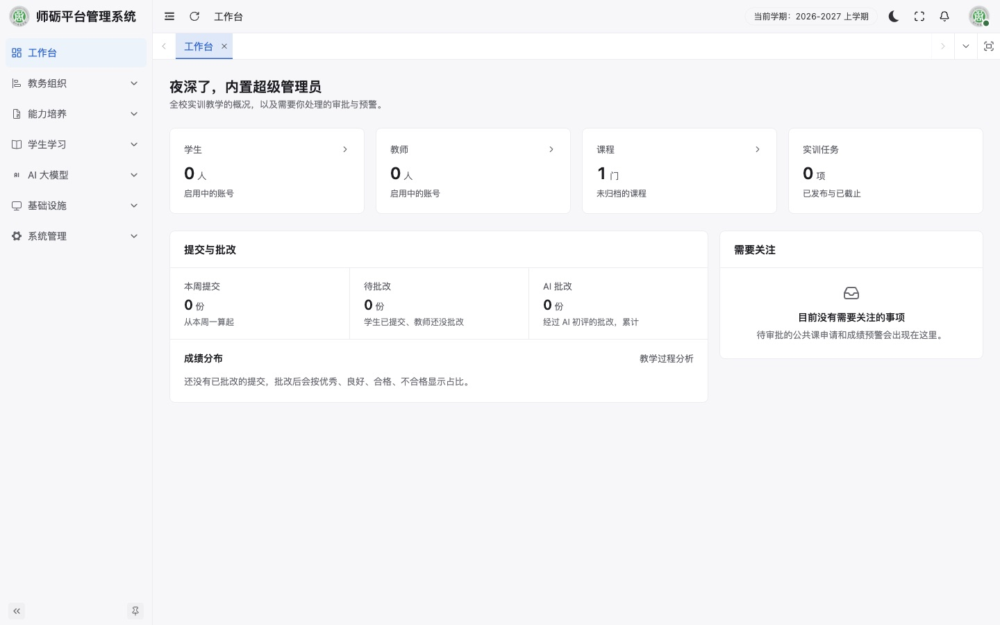

| 区域 | 说明 |
| --- | --- |
| 左侧菜单 | 所有功能入口。点击分组名称可以展开或收起。左下角的 « 按钮可以把菜单收窄。 |
| 顶部标签栏 | 每打开一个页面就多一个标签，点击标签可以快速切换，点 × 关闭。 |
| 顶部右侧 | 从左到右依次是：**当前学期**、深色/浅色切换（🌙）、全屏、**通知铃铛**、头像菜单。 |
| 中间内容区 | 当前页面的内容。 |

**② 学生：顶部导航布局**

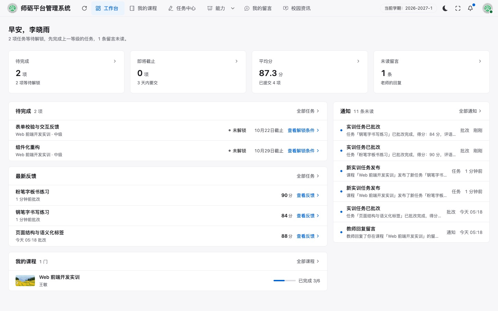

学生的功能都放在顶部一排：**工作台、我的课程、任务中心、能力（下拉）、我的留言、校园资讯**。

### 1.5 通知、个人中心与深色模式

**通知铃铛**：铃铛右上角有蓝点，说明有未读通知。新任务发布、任务被批改、被打回、收到留言、催交提醒等都会出现在这里。点击某条通知可以直接跳到对应页面；点击 **查看全部通知** 可以看到历史通知。

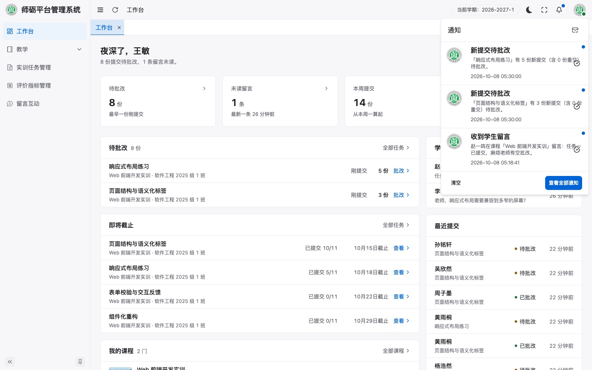

**个人中心**：点击右上角头像 → **个人中心**，可以修改姓名、手机、邮箱和密码，也可以绑定第三方账号。

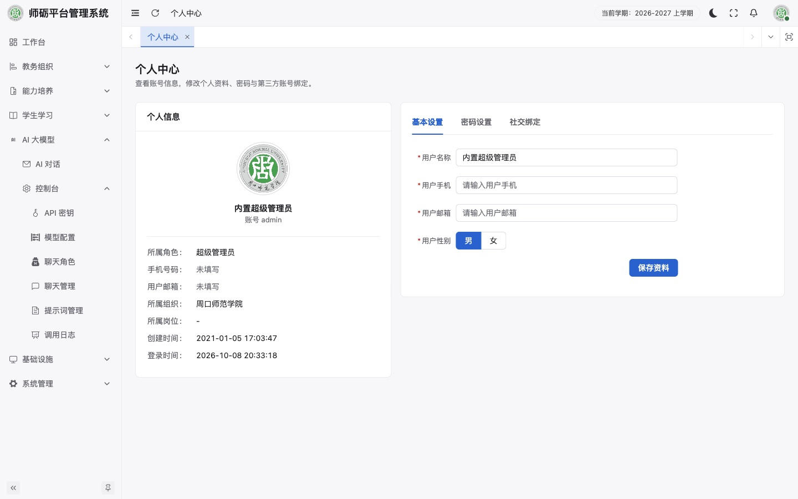

**退出登录**：点击右上角头像 → **退出登录**。在公用电脑上用完后，请务必退出。

**深色模式**：点击右上角的 🌙 图标，可以在深色和浅色两种主题之间切换。本手册的截图都是浅色主题。

---

## 第二章 管理员篇

### 2.1 谁是“管理员”

平台里有三类管理角色：

| 角色 | 能做什么 |
| --- | --- |
| **平台管理员**（超级管理员，例如 `admin`） | 所有功能：建组织和班级、建教师和学生账号、设置学期、维护能力指标、审批公共课、给课程添加班级、查看全校统计、配置 AI 等。 |
| **学校教务管理员** | 以**查看和审批**为主：维护组织架构，查看班级、教师、学生，**审批教师的公共课申请**，查看管理员看板。不能新建或修改班级和账号。 |
| **学院教务管理员** | **维护本学院的数据**：本学院的班级，以及教师、学生账号（新建、导入、修改、停用、重置密码）。看不到、也改不了其他学院的数据。不负责课程、任务、统计和公共课审批。 |

本章以平台管理员为主介绍；学校教务管理员请重点看 [2.10 公共课审批](#210-公共课审批) 和 [2.13 学校教务管理员](#213-学校教务管理员)，学院教务管理员请看 [2.14 学院教务管理员](#214-学院教务管理员)。

### 2.2 新学期准备流程

每个学期开学前，建议按下面的顺序准备，前一步做好了，后一步才有可选的数据：

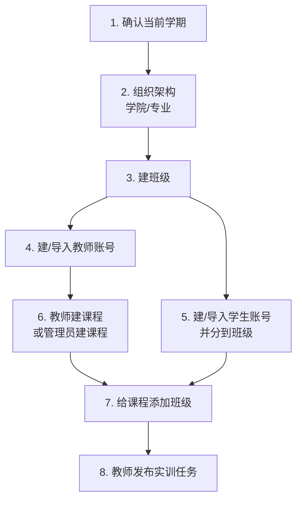

### 2.3 工作台（管理员看板）

登录后首先看到工作台，可以了解全校实训教学的整体情况：

- **学生 / 教师 / 课程 / 实训任务**：启用中的账号数、未归档的课程数、已发布的任务数。点击卡片可以跳到对应列表。
- **提交与批改**：本周提交数、待批改数、经过 AI 初评的批改数。
- **成绩分布**：已批改提交中优秀、良好、合格、不合格各占多少。
- **需要关注**：待审批的公共课申请、不合格占比偏高等预警，点击可以直接处理。

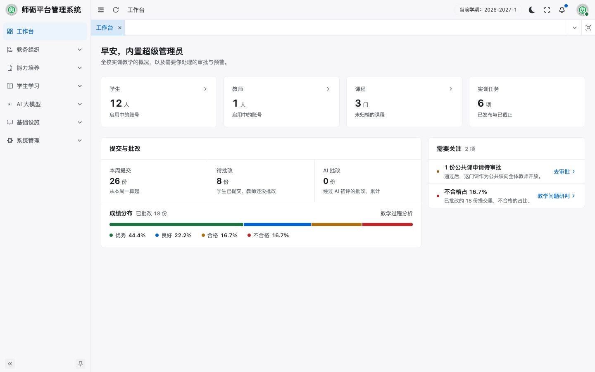

### 2.4 组织架构管理

路径：**教务组织 → 组织架构管理**

组织架构就是“学校 → 学院 → 专业”的树形结构，后面的班级、教师和学生都要挂在某个组织下面。

- **新建组织**：点击右上角 **新建组织**；也可以在某一行点 **新建下级**，在它下面加一个子组织。
- **修改 / 删除**：在行末操作。下面还有子组织的组织不能删除。
- **导入组织班级**：组织和班级比较多时，点击 **导入组织班级** → **下载模板** → 按模板填好 Excel → 选择文件 → **扫描并预览** → 确认导入。
- **导出组织班级**：把现有的组织和班级导出成 Excel，便于核对。

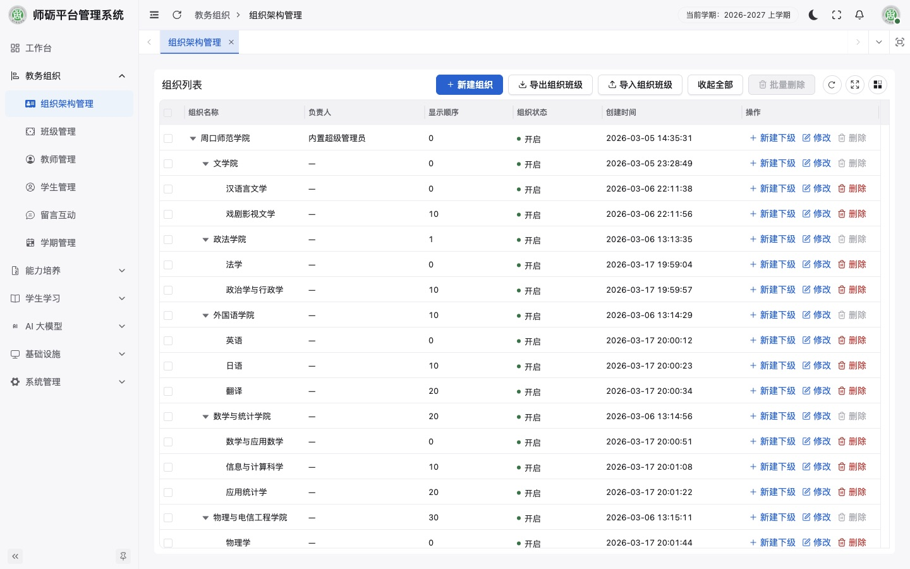

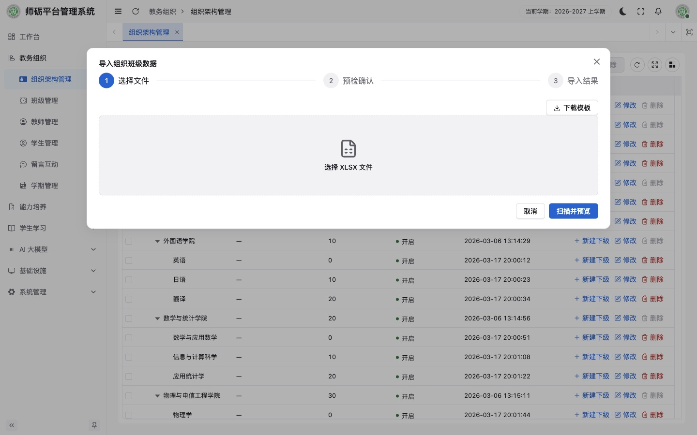

> 💡 所有“导入”功能都分三步：**选择文件 → 预检确认 → 导入结果**。预检阶段只做检查，不会写入数据，可以放心先看一遍。

### 2.5 班级管理

路径：**教务组织 → 班级管理**

左侧是组织树，点击某个学院或专业，右侧只显示它下面的班级。

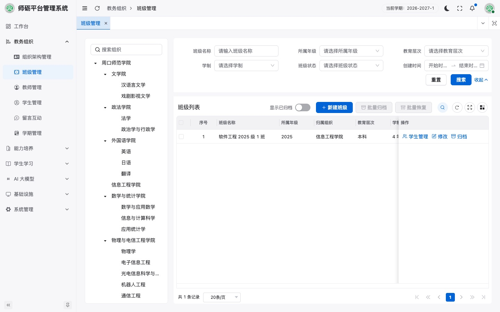

**新建班级**

1. 点击 **新建班级**。
2. 依次选择 **所属年级、归属组织、教育层次、学制**。
3. **班级名称会自动生成**（例如“2026级汉语言文学本科1班”）。如果需要改名，点击名称右侧的 **编辑**。
4. 点击 **确认**。

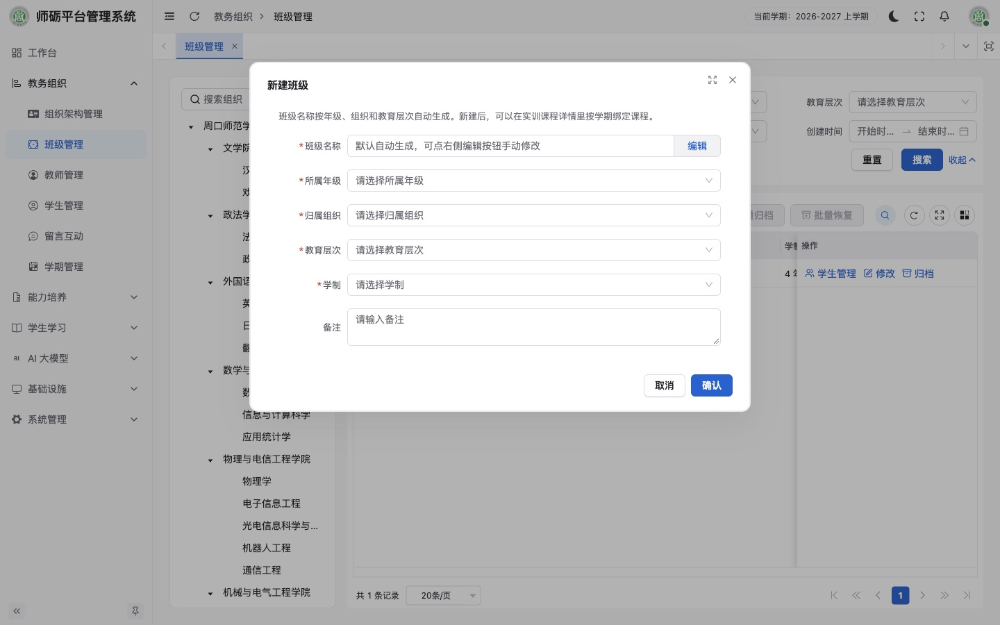

**给班级加学生**

在班级那一行点击 **学生管理**，弹出左右两栏的窗口：

- 左边“**可添加的学生**”：按学号、姓名、组织、年级查找，勾选后点 **添加 →**。
- 右边“**已在本班的学生**”：勾选后点 **← 移除**。
- 也可以用左下角的 **导出花名册 / 导入花名册** 批量处理。

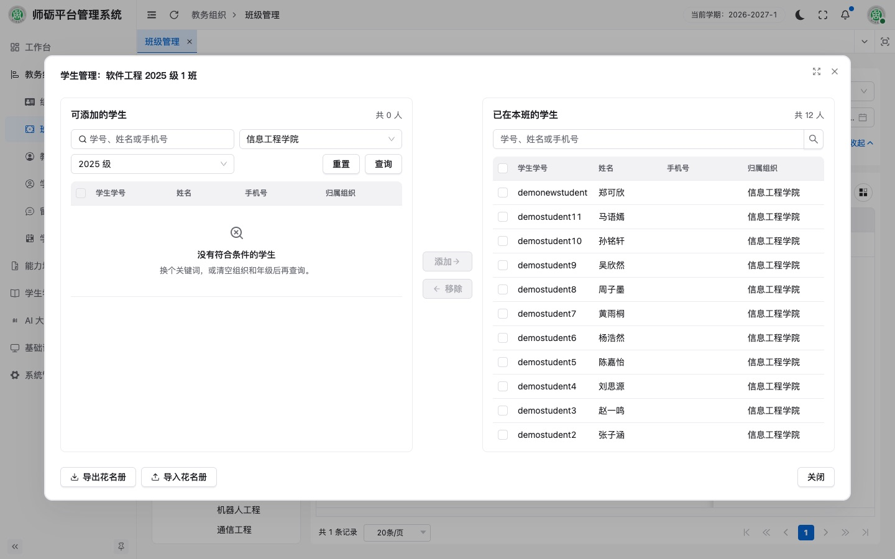

> 💡 学期中途有学生加入班级时，系统会自动把这个班**还没截止的任务**补发给他，不需要老师重新发布。

**归档班级**：毕业或不再使用的班级，点击 **归档** 即可（可以批量归档）。打开列表上方的 **显示已归档** 开关，可以找回并 **恢复**。

### 2.6 教师管理

路径：**教务组织 → 教师管理**

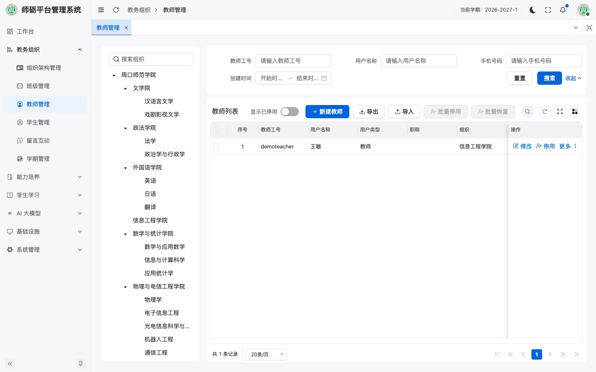

**新建教师**：点击 **新建教师**，填写**教师工号**（也就是登录账号）、**用户密码**（初始密码）、**用户名称**（姓名），可选填职称、归属组织、邮箱、手机号，然后点击 **确认**。

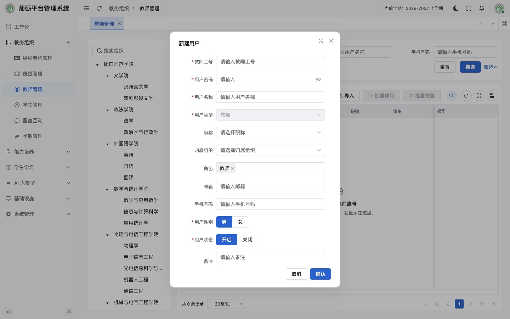

**批量导入**：点击 **导入** → 下载模板 → 填写 → 扫描并预览 → 确认导入。

**其他常用操作**（在每一行的操作列里）：

- **重置密码**：老师忘记密码时使用。
- **停用 / 恢复**：停用后该账号不能登录，可以随时恢复。列表默认不显示停用的账号，打开 **显示已停用** 才能看到。
- **分配角色**：例如让某位老师同时担任学校教务管理员。

### 2.7 学生管理

路径：**教务组织 → 学生管理**

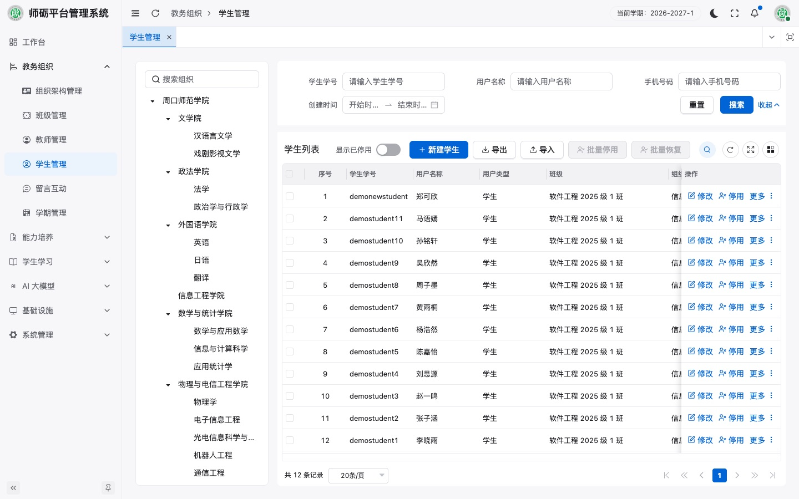

**新建学生**：点击 **新建学生**，填写**学生学号**（登录账号）、**用户密码**、**用户名称**，选择**归属组织、所属年级、班级**，然后点击 **确认**。

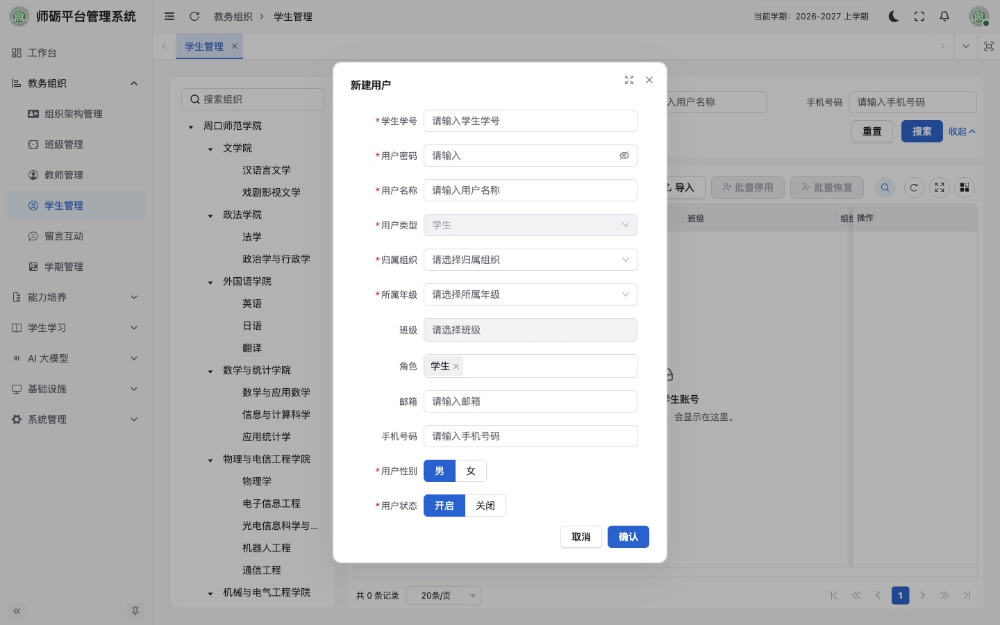

**批量导入学生（推荐）**

1. 点击 **导入** → **下载模板**。
2. 在“学生档案”工作表里填写**学号、姓名、班级**（必填），以及性别、手机号、邮箱、状态（选填）。
   - **班级**一列可以直接从下拉中选择现有班级。学生的专业和入学年份会按所选班级自动补全，导入后学生也会自动加入该班级。
   - 一名学生要加入多个班级，或者要跨专业、跨年级加入班级时，在“班级关系”工作表里再填一行，并写明备注。
   - 先在“组织架构”和“班级管理”里建好班级，再下载模板，下拉里才会出现这些班级。
3. 选择填好的 XLSX 文件 → **扫描并预览**，检查哪些是新增、哪些是更新、哪些会跳过。按班级自动入班的行会显示在“学生档案（入班）”下。
4. 设置初始密码：**新建的学生默认用各自的学号作为初始密码**，也可以统一设置一个；已经存在的账号，密码保持不变。
5. 点击 **确认导入**。导入在服务器后台进行，窗口里会显示已用时间；几百人的导入大约需要一分钟，完成后自动显示导入结果。等待期间也可以点 **关闭窗口，后台继续**，稍后刷新列表查看。

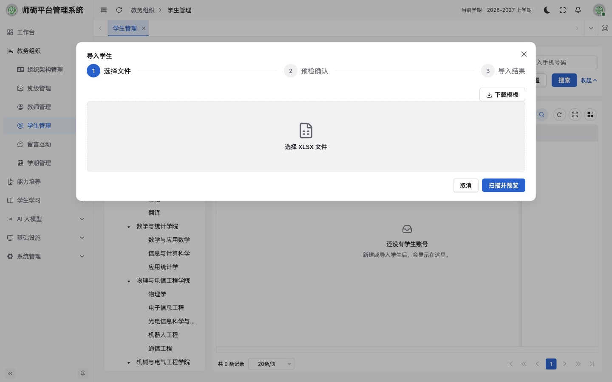

> ⚠️ 学生第一次登录时必须修改初始密码。请把“账号 = 学号，初始密码 = 学号（或你统一设置的密码）”告诉学生。

### 2.8 学期管理

路径：**教务组织 → 学期管理**

当前学期会显示在每个页面的右上角。新任务、班级课程、统计都按学期来区分。

- **自动更新（推荐打开）**：每年 2 月 1 日自动切换到下学期，8 月 1 日自动切换到新学年的上学期。
- **手动设置**：关闭自动更新后，可以手动选择学年、学期和起止日期，然后点击 **保存手动设置**。

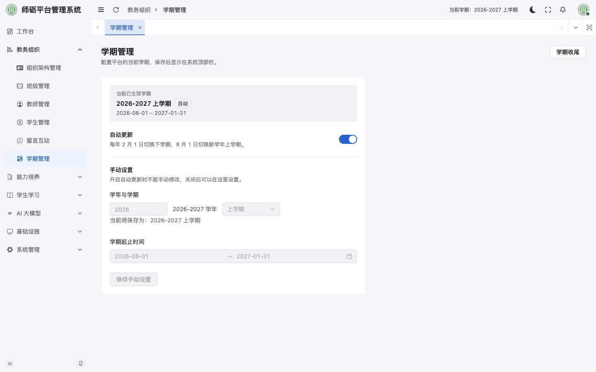

**学期收尾**

学期结束、切换到新学期之后，可以点右上角 **学期收尾**，把旧学期的班级课程统一归档。它分四步：**预览 → 选择 → 确认 → 结果**。

- 预览页会列出这个学期**在用的班级课程、进行中的任务、等待批改的提交**。
- 如果还有进行中的任务或待批改的提交，建议先让老师批改完、等任务截止后再收尾。
- 归档后，已有的提交、成绩和评语**全部保留**；需要时可以在“课程详情 → 班级 → 显示已归档”里恢复。

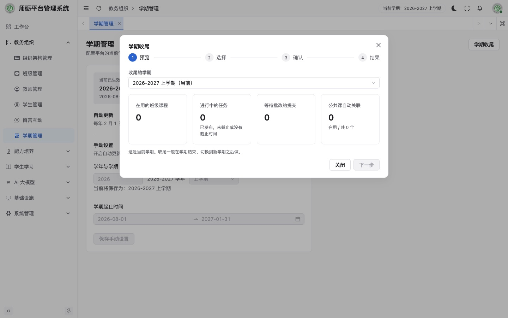

### 2.9 评价指标与证书配置

**评价指标管理**（路径：**能力培养 → 评价指标管理**）

左边是一级指标，右边是选中的一级指标下的二级指标。

- 一级指标的权重合计不超过 100%；每个一级指标下，二级指标的权重合计也不超过 100%。
- 点击 **新建一级指标 / 新建二级指标** 添加；点击 **重设指标权重** 统一调整权重。
- 已经被任务使用的指标不能删除。

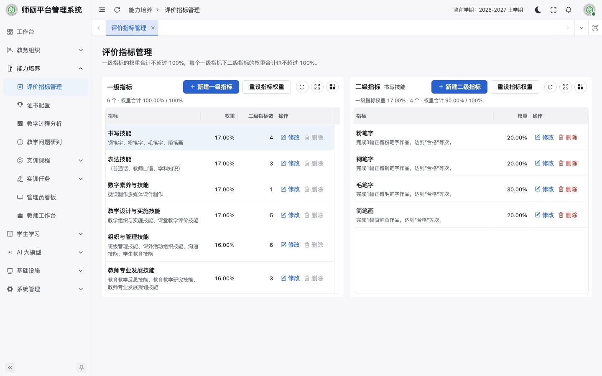

**证书配置**（路径：**能力培养 → 证书配置**）：设置学生获得证书所需的能力达标率，例如 75%。

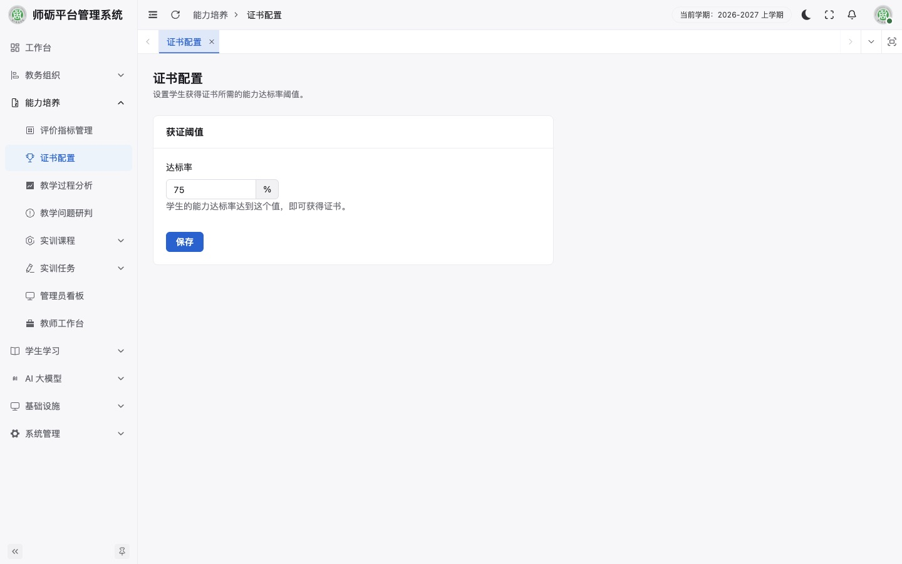

### 2.10 公共课审批

路径：**能力培养 → 实训课程 → 实训课程管理**

老师新建课程时选择“申请公共课：是”，课程就会出现在 **待我审批** 分组里，并标注“待审批”。同时工作台的“需要关注”里也会提示。

- 点击 **查看详情**，了解课程内容；
- 点击 **审批通过**，课程成为公共课，所有老师都能看到；
- 点击 **驳回**，课程退回为专属实训，并通知申请的老师。

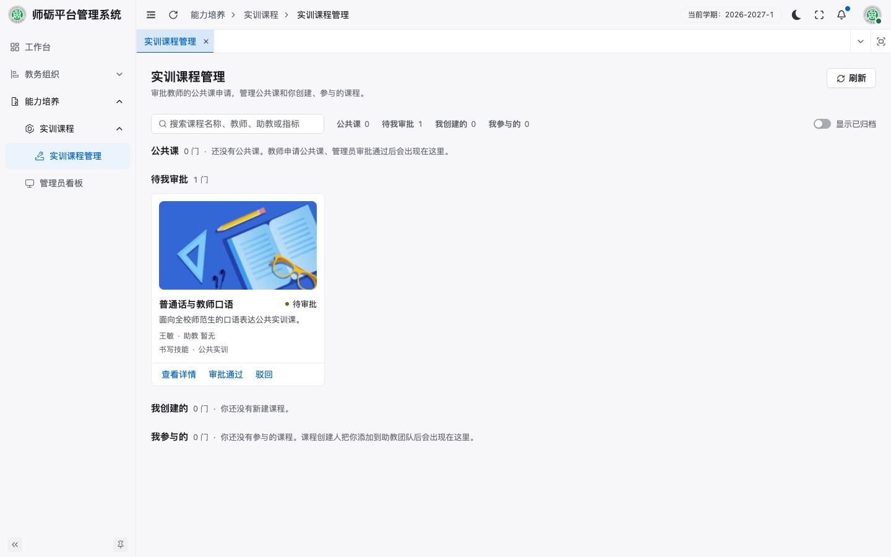

> 💡 公共课审批通过后，**现有的班级和以后新建的班级都会自动关联这门课**，不需要逐个添加。

### 2.11 给课程添加班级

只有课程添加了班级，老师才能给这个班发布任务。

1. 进入 **实训课程管理**，在课程卡片上点击 **查看详情**。
2. 在 **班级** 页签中点击右侧的 **添加班级**。
3. 选择 **学期**（默认是当前学期），再选择要添加的班级（可以多选，也可以点 **全选可选**）。
4. 点击 **添加**。

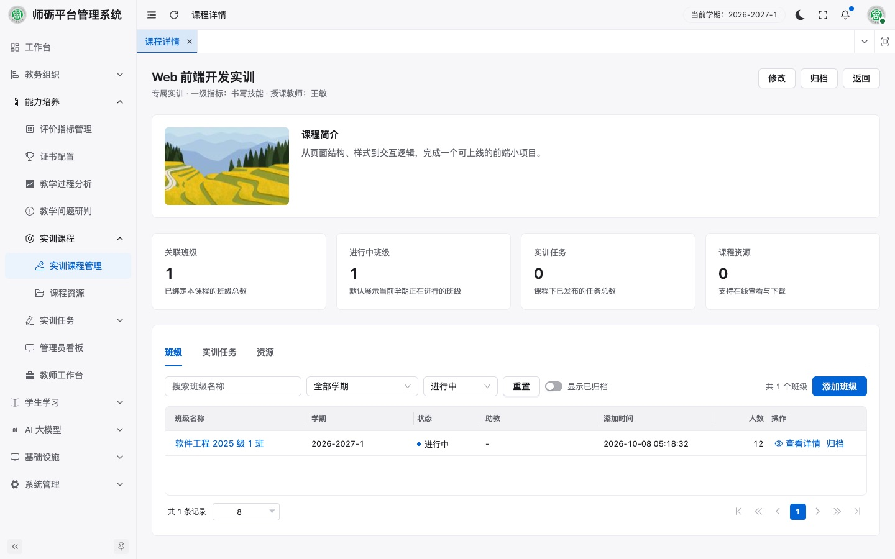

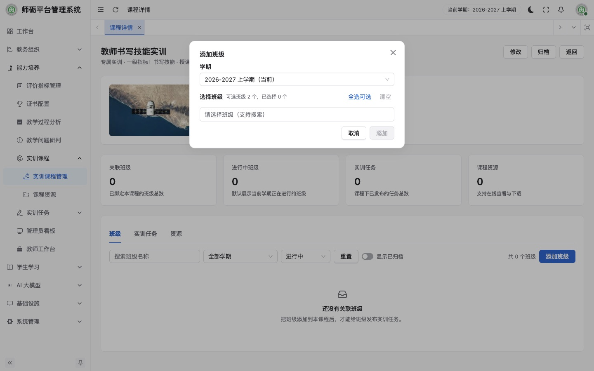

> 💡 课程负责人和课程团队成员（助教）也可以自己给课程添加班级，步骤相同。其他老师即使能看到公共课，也不能给它添加班级。

### 2.12 教学分析与 AI 设置

**教学过程分析**（**能力培养 → 教学过程分析**）：选择课程和班级后，可以看到任务成绩的波动（最高分、平均分、最低分）、成绩结构分布、表现最好的任务和需要重点跟进的任务。

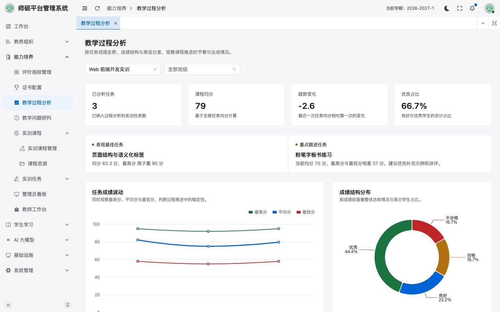

**教学问题研判**（**能力培养 → 教学问题研判**）：从教学节奏、任务适配、分层支持、结果保障四个维度给出研判得分和风险等级，帮助找出需要优先处理的教学问题。请先选好**课程、班级和实训任务**再看结果。

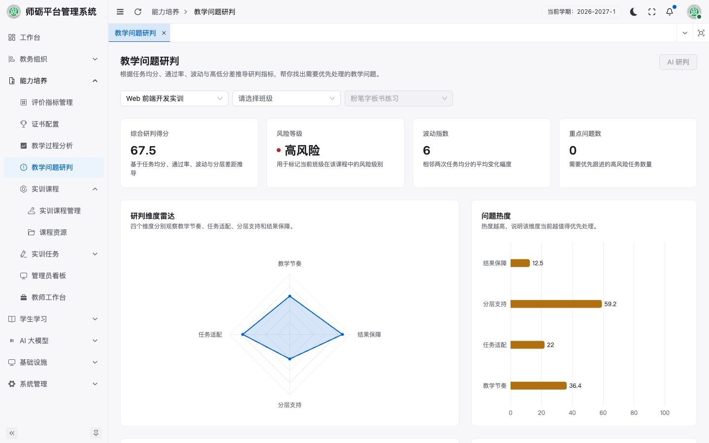

> 💡 这两个页面的结论由系统根据成绩自动生成，只作为参考，不能代替老师的专业判断。数据越多，结论越可靠。

**AI 提示词管理**（**AI 大模型 → 控制台 → 提示词管理**）：可以查看和修改“任务 AI 初评”“班级学情分析”“学生综合评语”等 AI 功能所用的提示词。每次保存都会生成一个新版本，旧版本可以随时重新启用。模型配置和 API 密钥一般由技术人员维护。

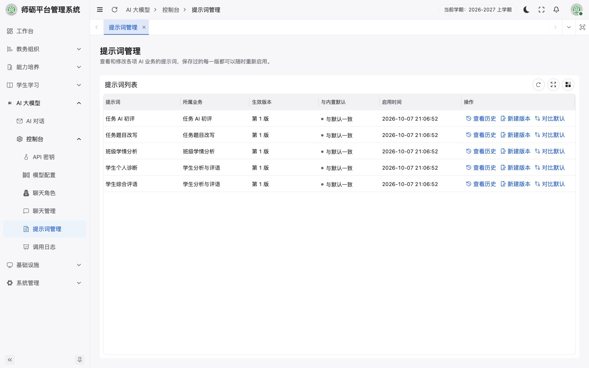

### 2.13 学校教务管理员

学校教务管理员登录后，左侧菜单只有 **工作台、教务组织、能力培养** 三组，主要做三件事：

1. **看全校概况**：工作台显示学生、教师、课程、任务数，以及提交、批改和成绩分布。
2. **审批公共课**：见 [2.10](#210-公共课审批)。工作台“需要关注”里会提示待审批的申请。
3. **维护组织、查看名单**：组织架构可以新建、修改；班级、教师、学生列表只能查看和搜索。需要建班级、建账号或调整名单时，请联系平台管理员。

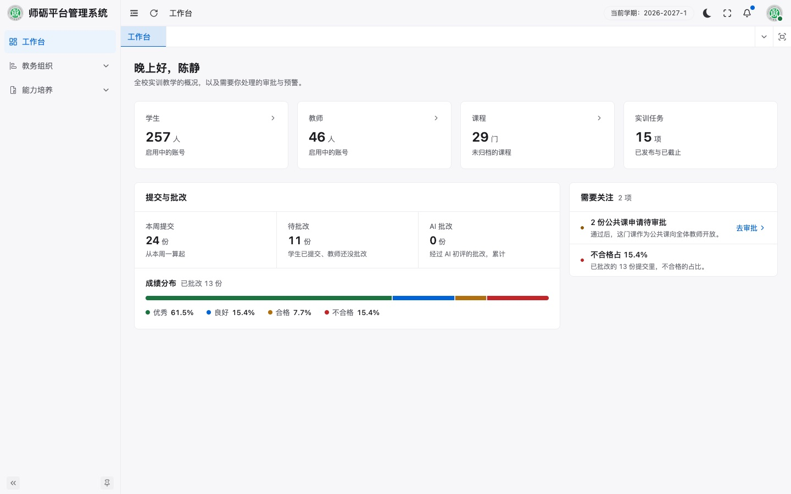

### 2.14 学院教务管理员

学院教务管理员负责**本学院**的日常维护，页面和操作与平台管理员相同，只是范围限定在本学院：

- **组织架构**：只能看到本学院及其下属专业，不能新建、修改、删除组织；
- **班级管理**：新建、修改、归档本学院的班级，并在“学生管理”里为班级添加或移除本学院的学生；
- **教师管理、学生管理**：新建、导入、修改、停用、恢复本学院的账号，并可以重置密码、导出名单；
- **导入**：导入文件中如果有其他学院的数据，预检时这些行会被跳过，原因写“不在本学院”，本学院的行照常导入。

> ⚠️ 使用前提：学院教务管理员的账号必须挂在**学院**这一级组织下（在“教师管理”或“用户管理”里设置所属组织）。账号没有设置所属学院时，系统会提示“账号未设置所属学院，请联系管理员”。

> 💡 课程、实训任务、统计看板和公共课审批不在学院教务管理员的范围内，仍由平台管理员和学校教务管理员负责。

---

## 第三章 教师篇

### 3.1 老师的一学期

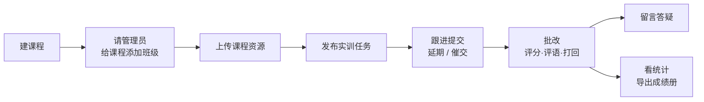

老师的左侧菜单是：**工作台、教学（实训课程管理、课程资源、题库管理）、实训任务管理、评价指标管理、留言互动**。

### 3.2 工作台

工作台是老师每天的起点：

- **待批改**：还有多少份提交没批，最早的一份是什么时候交的。
- **未读留言**：学生给你的留言。
- **本周提交 / 我的课程**。
- **待批改** 列表：按任务分组，点击 **批改** 直接进入批改页。
- **即将截止**：最近要截止的任务和已提交人数，例如“已提交 10/11”。
- **学生留言 / 最近提交**：最新的动态。

右上角的 **去批改**、**查看留言** 是两个最常用的快捷入口。

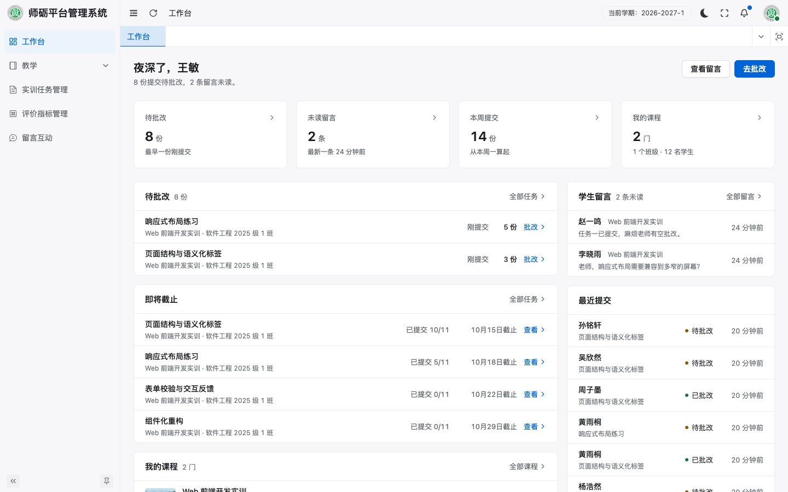

### 3.3 建课程

路径：**教学 → 实训课程管理**

课程分为三组：**公共课**（审批通过、全校可用）、**我创建的**、**我参与的**（别人把你加为助教的课程）。

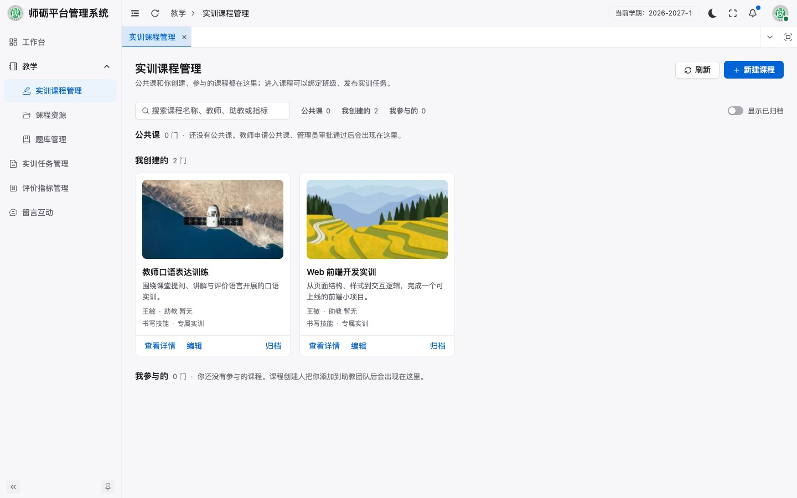

**新建课程**

1. 点击右上角 **新建课程**。
2. 填写 **课程名称**、**课程简介**。
3. **课程图片**：可以自己上传（不超过 5MB），不选的话系统会自动配一张默认图片。
4. **关联指标**：选择这门课主要培养的一级能力指标。
5. **申请公共课**：选“是”会提交给学校教务管理员审批；选“否”就是你自己的专属实训课程。
6. **助教团队**：可以选其他老师作为助教，他们也能管理这门课。
7. 点击 **新建**。

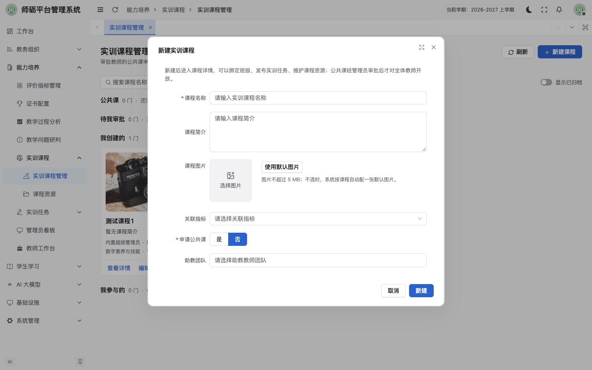

> ⚠️ 新建课程后，记得**给课程添加班级**：进入课程详情 → **班级** 页签 → **添加班级**，选择学期和班级后点 **添加**。添加之前，课程下没有班级，无法发布任务。课程团队成员（助教）也可以添加。

**课程详情**：在课程卡片上点击 **查看详情**，可以看到关联班级、实训任务、课程资源三个页签，以及班级人数等信息。

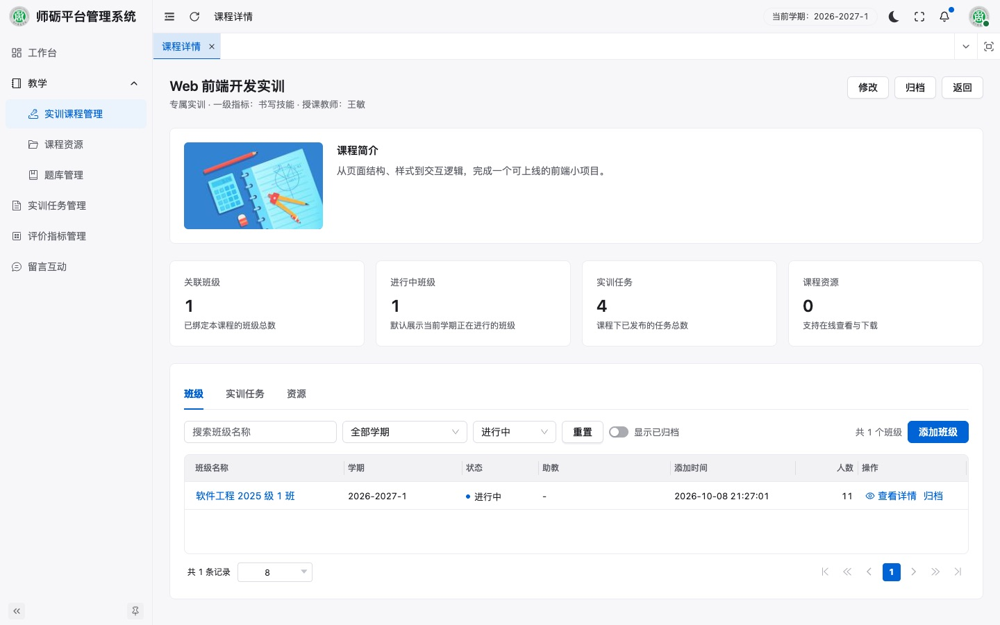

### 3.4 上传课程资源

路径：**教学 → 课程资源**

1. 在左侧选择课程。
2. 点击 **上传资源**，把文件拖进框里，或者点击选择文件。支持视频、音频、图片、PDF、Word、PPT、Excel、文本和压缩包，可以一次选多个文件，单个文件不超过 500MB。
3. 上传后，Word、PDF、PPT 和音视频可以直接在线预览。学生在“我的课程 → 课程详情 → 资源”里查看和下载。

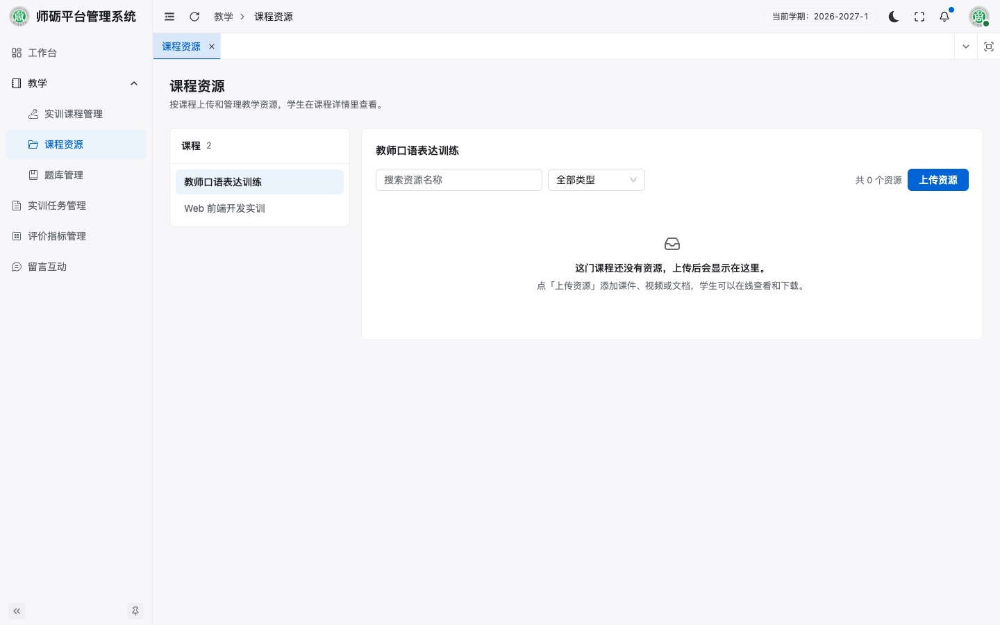

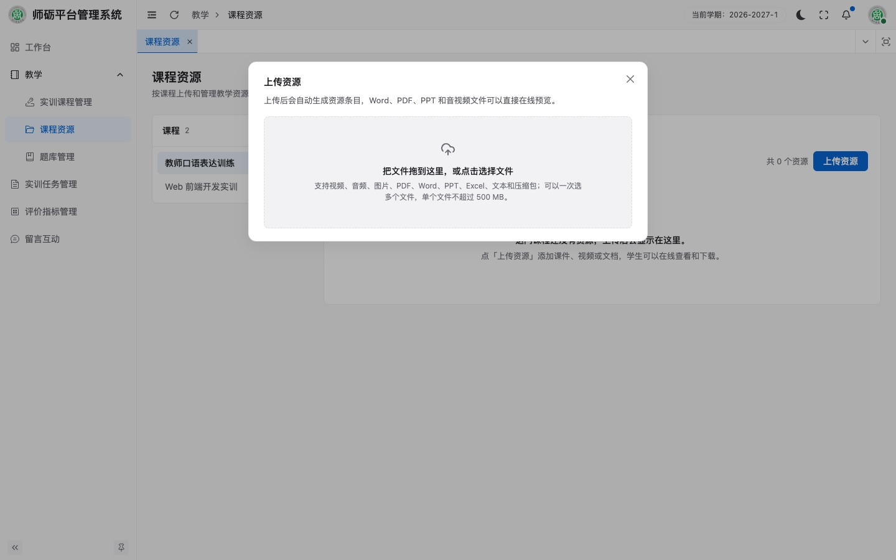

> 💡 建议在发布任务之前，先把学生完成任务需要参考的资料上传好。

### 3.5 发布实训任务

路径：**实训任务管理 → 新建实训任务**

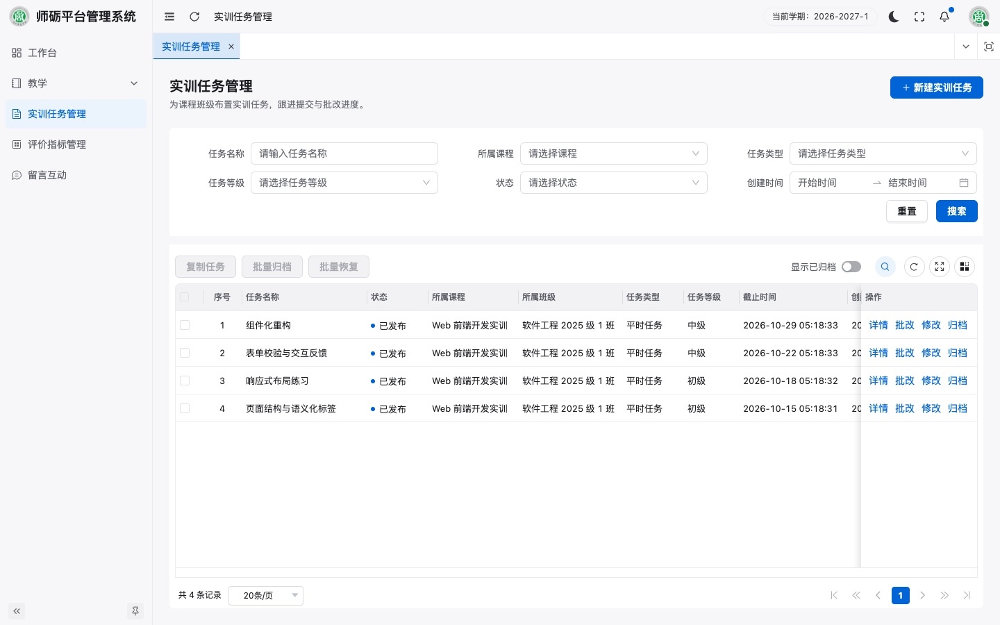

**第一步：选课程和指标**

- **指定课程**：选择任务属于哪门课程。
- **一级指标**：选好课程后选择。这一项会决定后面“二级指标”和“指定班级”的选项。

**第二步：填写任务配置**

| 字段 | 说明 |
| --- | --- |
| 任务名称 | 必填，例如“粉笔字正楷练习”。 |
| 指定班级 | 选择发给哪个班。只能选这门课已经添加的班级。 |
| 任务类型 | **平时任务** 或 **考核任务**。 |
| 任务等级 | 初级 / 中级 / 高级。学生要先完成较低等级的任务，才能解锁较高等级。 |
| 二级指标 | 建议填写，否则这次成绩不会计入学生的能力分析。 |
| 截止时间 | 必填。过了截止时间，学生就不能再提交（单独延期的学生除外）。 |
| 批改方式 | **仅人工批改**，或 **AI 初评 + 教师复核**（学生提交后 AI 先给出初评草稿，老师确认后才算最终成绩）。 |
| 提交模式 | 纯文本、图片、音频、视频或混合，用来限制学生能上传的附件类型。 |
| 及格分数线 / 满分值 | 默认 60 / 100。 |
| 任务内容 | 用编辑器写清楚任务要求，可以插入图片和表格。 |

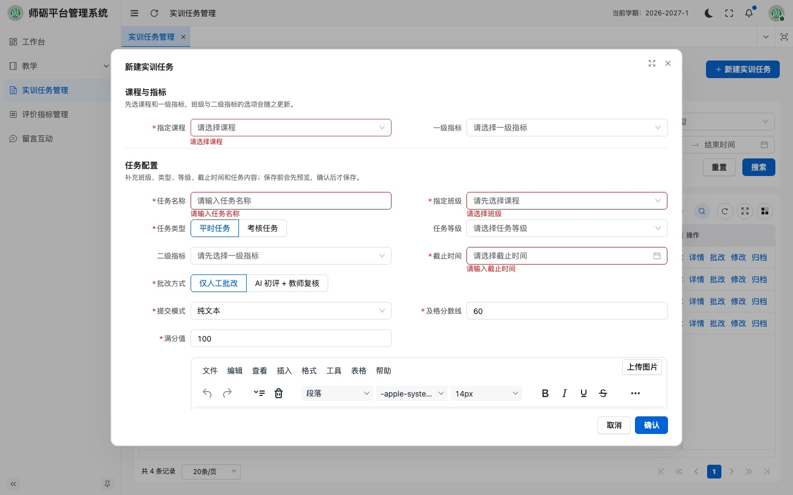

**第三步：预览并发布**

点击 **确认** 后，会弹出预览窗口，核对课程、班级、指标、截止时间和任务内容。确认无误后点击 **新建**，任务立即发布，学生会收到“新实训任务发布”的通知。需要修改的话，点击 **返回**。

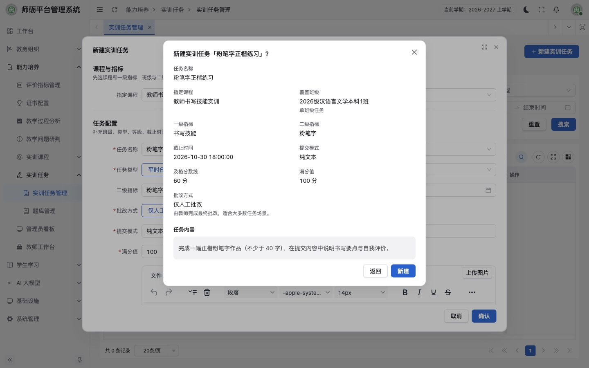

> 💡 **一级指标和二级指标请尽量填写。** 不挂指标的任务，成绩不会出现在学生的“能力分析”里。

### 3.6 跟进任务：延期、催交、复制

在任务列表中点击 **详情**，可以看到任务覆盖人数、已提交、已批改、达标人数，以及任务的完整信息。

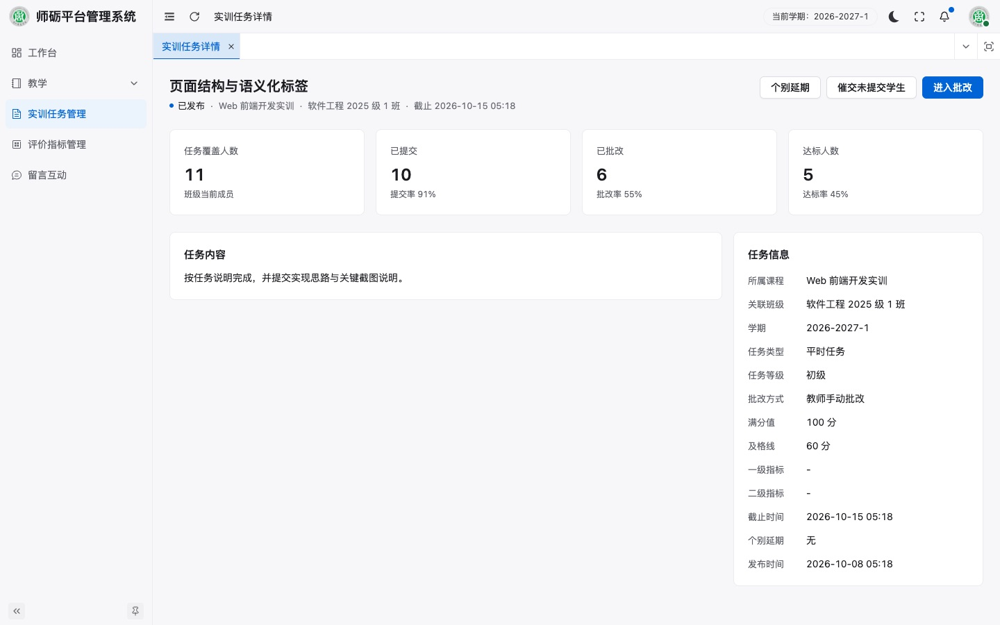

**个别延期**：某位学生因病假等原因需要晚交时使用。

1. 点击 **个别延期**。
2. 选择学生（只能选还没提交的学生），也可以点 **选中全部未提交**。
3. 设置 **延期到** 的时间，选填原因（学生能看到）。
4. 点击 **保存延期**。系统会通知被延期的学生。

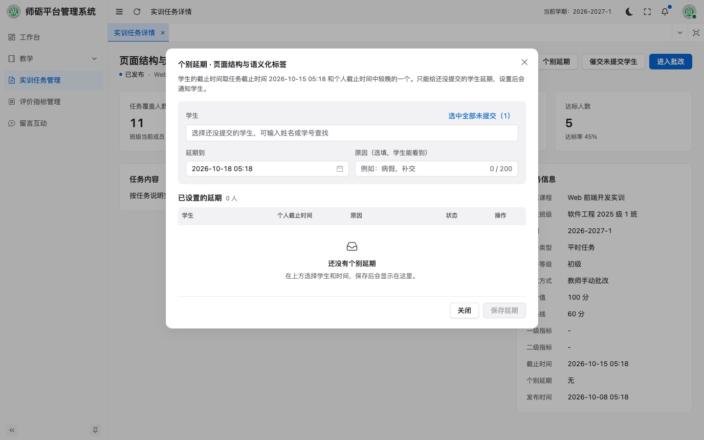

**催交未提交学生**：点击 **催交未提交学生** → **催交**，系统会给还没提交、也还没过截止时间的学生各发一条提醒。同一个任务，60 分钟内只能催交一次。另外，系统会在截止前 24 小时自动提醒一次未提交的学生。

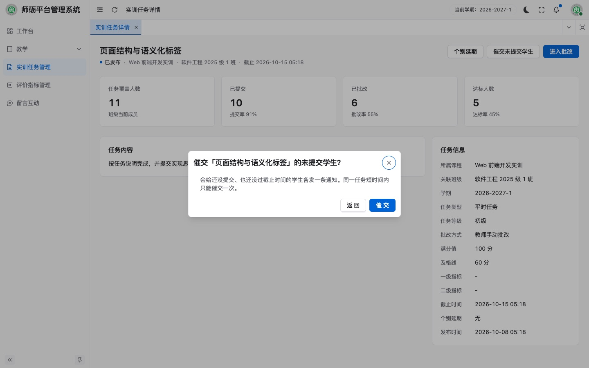

**复制任务**：同一个任务要发给另一个班时，在任务列表勾选任务 → **复制所选** → 选择学期和目标班级 → **复制为草稿**。复制出来的任务内容、分数、批改方式和指标都不变，**截止时间会被清空**。在草稿里设好截止时间并发布后，学生才能看到。

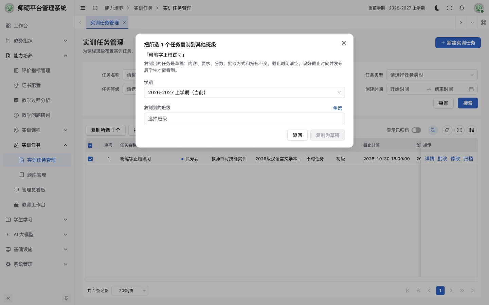

**归档任务**：不再使用的任务点 **归档**。归档后学生看不到这个任务，已有的成绩保留。

### 3.7 批改

路径：任务列表点 **批改**，或在工作台点 **去批改**。

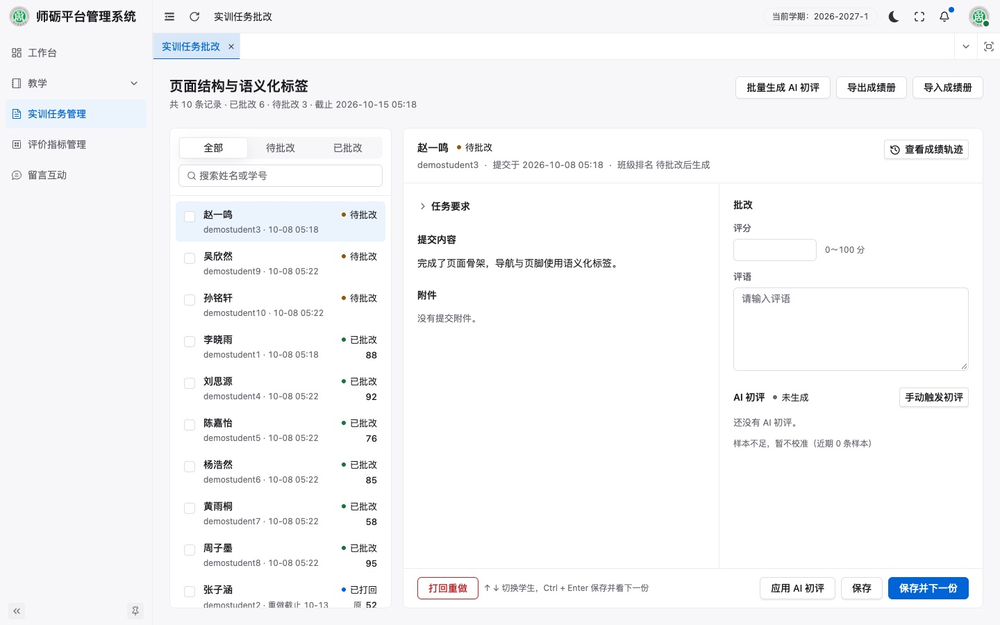

页面分为三栏：

- **左栏：学生名单**。可以按“全部 / 待批改 / 已批改”筛选，也可以搜索姓名或学号。每个学生后面都标有状态和分数。
- **中栏：学生的提交**。包括提交内容、附件，点击“任务要求”可以展开对照。
- **右栏：批改**。填写**评分**和**评语**，查看 AI 初评。

**批改步骤**

1. 在左栏点选一个“待批改”的学生。
2. 阅读中栏的提交内容和附件。
3. 在右栏填写评分（0～满分）和评语。
4. 点击 **保存并下一份**，系统会自动跳到下一位待批改的学生。

> ⌨️ 快捷键：键盘 **↑ / ↓** 切换学生，**Ctrl + Enter** 保存并看下一份。批改大量作业时非常省时间。

> ⏱️ 保存后有 **10 秒撤销时间**，可以撤回刚才的批改。撤销时间过后，学生才会收到“任务已批改”的通知。

**打回重做**

学生的提交明显不符合要求时，点击左下角的红色 **打回重做**，选择**重做截止时间**，再点击 **打回**。

- 学生会收到通知，可以修改后重新提交；
- 原来的成绩会作为“原成绩”保留；
- 打回后几秒内可以撤销；
- 学生重新提交前，可以随时点击 **调整重做期限**。

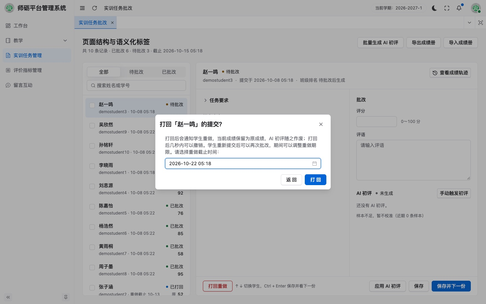

**成绩轨迹**：点击 **查看成绩轨迹**，可以看到这份提交的完整经过：什么时候提交、谁批改、给了多少分、是否打回、原成绩和原评语是什么。

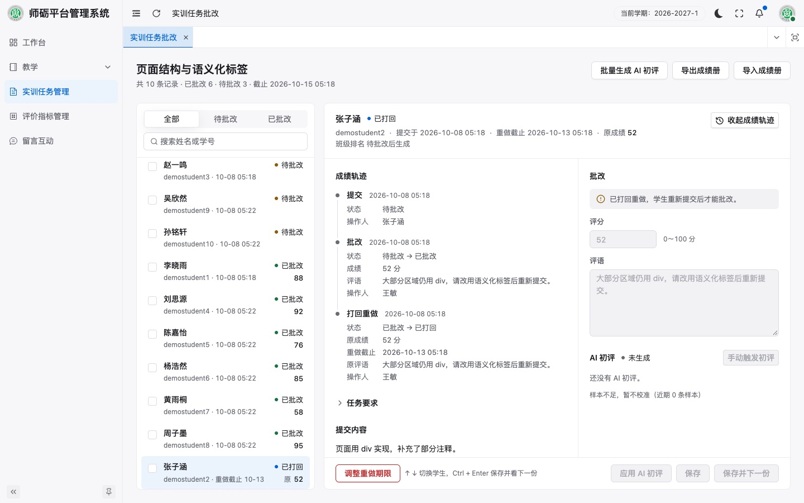

**AI 初评**（任务批改方式为“AI 初评 + 教师复核”时）

- 学生提交后，AI 会在后台排队生成初评草稿，右栏会显示“排队中 / 处理中 / 已就绪”。
- 草稿就绪后，点击 **应用 AI 初评** 把分数和评语填进来，修改后再保存。
- 也可以点 **手动触发初评**，或点页面右上角 **批量生成 AI 初评**。
- AI 给的只是建议，**最终成绩以老师保存的为准**。

**成绩册导出与导入（线下批改用）**

1. 点击右上角 **导出成绩册**，得到一份 Excel。
2. 在 Excel 里填写分数和评语。
3. 点击 **导入成绩册** → 选择文件 → **扫描并预览**。预检会说明每一行是“将写入”还是“跳过”，以及跳过的原因（例如没有改动、没填成绩、待学生重交、学生未提交）。
4. 确认导入。

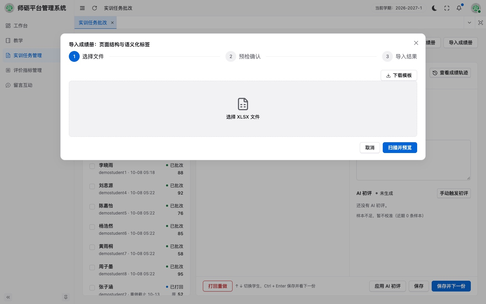

### 3.8 留言互动

路径：**留言互动**

1. 在右上角选择 **班级** 和 **课程**。
2. 左侧会列出给你留言的学生，有未读消息的学生后面带蓝点和数字。
3. 点击学生，右侧显示对话记录。在下方输入框里输入回复，按 **Enter** 发送（**Shift + Enter** 换行）。
4. 问题解决后，可以点击 **关闭留言**；需要继续交流时可以重新开启。

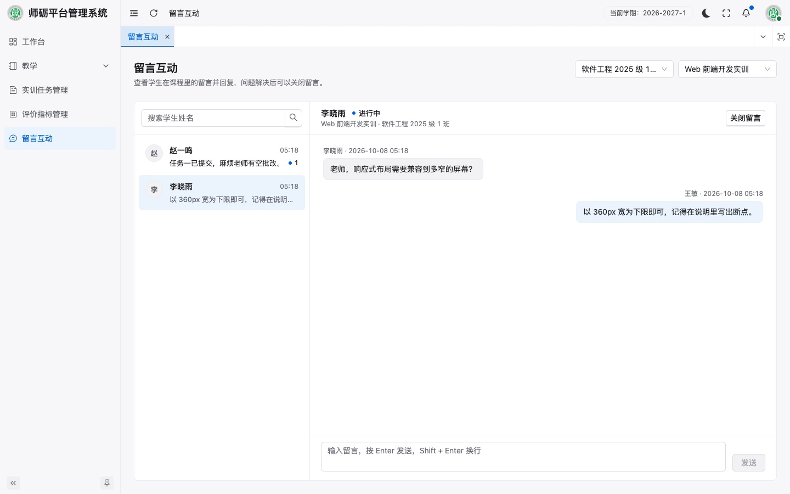

> 💡 课程负责老师、课程助教团队都会收到学生的留言通知，谁先打开谁处理即可。

### 3.9 题库管理

路径：**教学 → 题库管理**

可以按能力指标和任务等级整理常用的任务题目。点击 **导入题库**，按模板从 Excel 批量导入；可以按一级指标、二级指标、等级、标题搜索。新建任务时可以参考题库里的题目。

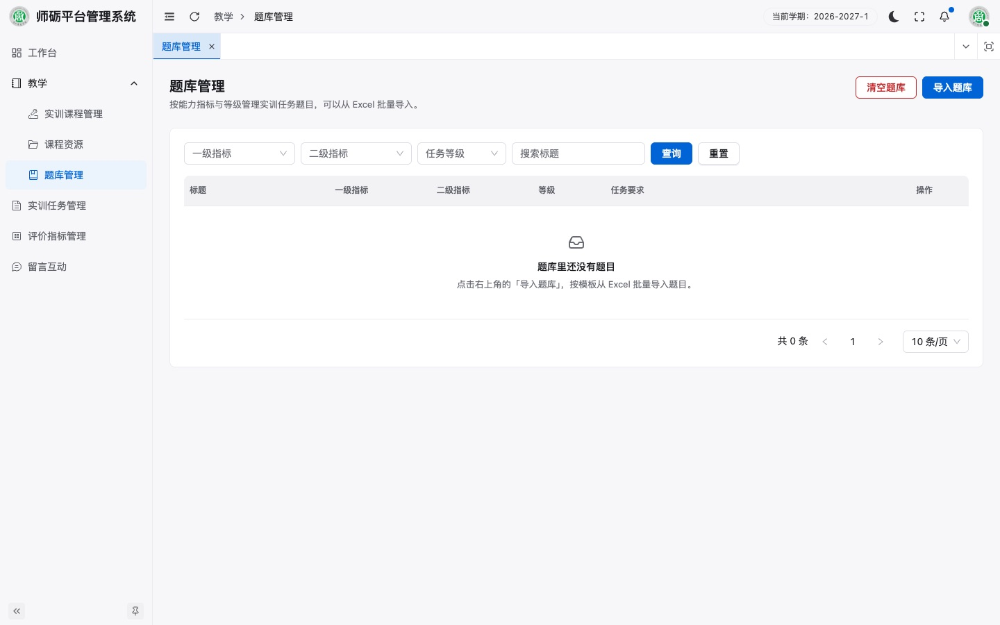

---

## 第四章 学生篇

### 4.1 学生的日常

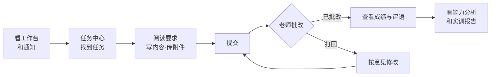

### 4.2 工作台

登录后首先看到工作台：

- **待完成**：还有几项任务要做，其中有几项在“等待解锁”。
- **即将截止**：3 天内要交的任务，请优先完成。
- **平均分**、**未读留言**。
- **待完成** 列表：显示每个任务的截止日期。还没解锁的任务可以点 **查看解锁条件**。
- **最新反馈**：老师刚批改的任务和分数，点 **查看反馈** 看评语。
- **通知**：新任务、批改结果、老师回复等。
- **我的课程**：每门课的完成进度。

### 4.3 我的课程

点击顶部 **我的课程**。课程按一级能力指标分组，每门课都显示达标进度。点击课程进入详情。

**课程详情** 有三个页签：

- **实训任务**：这门课的所有任务及其状态，点击 **查看任务** 进入。
- **资源**：老师上传的课件和参考资料，可以在线查看或下载。
- **等级闯关**：初级、中级、高级的解锁情况。

**等级闯关怎么解锁？**

- 只统计**已截止或已提交**的任务。
- 上一等级任务的**达标比例达到 80%** 后，自动解锁下一等级；解锁后不会再被收回。
- 如果有任务正在等老师批改，页面会提示“有 1 个任务在等教师批改，达标后即可解锁”。

右上角的 **联系老师** 可以直接给这门课的老师留言。

### 4.4 任务中心：找任务、交任务

点击顶部 **任务中心**。

- **当前任务**：本学期的任务；**往期任务**：以前学期的任务。
- 可以按状态筛选：未提交、待批改、已批改、已打回。
- 还没做的任务点 **去提交**，已经交过的点 **查看**。
- 还没解锁的中级、高级任务显示 **未解锁**，操作是 **查看解锁条件**，鼠标停在上面能看到原因。

**提交任务**

1. 先读清楚 **任务要求**，并留意右侧的 **截止时间、满分、及格线、提交方式**。
2. 在 **提交内容** 框里写清楚实践过程、完成结果和关键结论。
3. 需要上传作品时，点击 **选择文件** 添加附件：最多 10 个，单个不超过 100MB，合计不超过 300MB。如果任务规定了提交方式（例如只收图片或视频），只能上传对应类型的文件。
4. 检查无误后，点击 **提交**。

> 💡 输入的文字会**自动保存草稿在本机**，页面不小心关掉也不会丢。但草稿只保存在当前这台电脑的浏览器里，换电脑就看不到了。

> ⚠️ 提交后，在老师批改之前**不能修改**。请提交前再检查一遍。

**任务还没解锁怎么办？**

打开中级或高级任务时，如果看到“这个任务还没有解锁”，说明上一等级的任务还没达标。先把较低等级的任务做好，或者等老师批改完，满足条件后会自动解锁。

### 4.5 被打回后重新提交

收到“任务被打回”的通知后，打开这个任务：

- 页面顶部会显示 **老师的评语**，告诉你需要怎么改；
- 右侧显示 **重做截止** 时间，请在这个时间之前完成；
- 修改内容或附件后，点击 **重新提交**。

### 4.6 查看成绩与反馈

任务批改后，在任务中心点击 **查看**，或在工作台点击 **查看反馈**：

- **批改结果**：我的成绩、是否达标、及格线；
- **教师评语**；
- **成绩轨迹**：提交、批改、打回、重交的完整记录；
- **我的提交**：当时提交的内容和附件。

### 4.7 能力分析与实训报告

点击顶部 **能力**，下拉菜单里有三个页面。

**能力分析**：按已经评定的任务，统计你在各项能力指标上的达标率，标出优势和需要补强的能力。

**实训报告**：汇总任务完成、能力达标和排名变化。点击右上角 **导出 PDF** 可以保存下来，用于存档或提交。

**单项能力评测**：查看在一级、二级指标上的详细达成情况、成长趋势和学习提示。

> 💡 只有老师在任务上**挂了能力指标**、并且**已经批改**的任务，才会计入能力分析。所以刚开学时这几个页面可能是空的，这是正常的。

### 4.8 我的留言

点击顶部 **我的留言**，左侧列出各门课程的留言，有新回复的会带蓝点。点击课程即可查看对话并继续留言。也可以在课程详情页点 **联系老师** 发起留言。

### 4.9 个人中心与校园资讯

**个人中心**：点击右上角头像 → **个人中心**，可以查看姓名、学号、院系、班级、入学年份，并在右侧 **修改密码**（修改后需要重新登录）。

**校园资讯**：顶部 **校园资讯** 汇总学校要闻与特别关注，点击标题查看全文。

### 4.10 微信小程序（如学校已开通）

学校开通“师砺平台”微信小程序后：

- 先在网页端登录，进入 **个人中心 → 社交绑定**，生成绑定码，用微信扫码确认绑定。
- 绑定后，可以在网页登录页选择“微信小程序扫码登录”，用微信扫码确认，不用再输入密码。
- 学生可以在小程序里查看自己的任务和截止时间，上传图片、音频、视频，提交或重新提交任务，并查看老师的反馈。

---

## 第五章 常见问题

**Q1：登录提示账号或密码错误？**
先检查大小写和输入法（全角/半角）。学生账号一般是学号。连续出错时请联系管理员重置密码。

**Q2：学生看不到老师发布的任务？**
请按顺序检查：
① 学生是否在这个班里（管理员 → 班级管理 → 学生管理）；
② 课程是否已经添加了这个班级，并且是当前学期；
③ 任务是否已经发布（复制出来的草稿需要设置截止时间并发布）；
④ 任务是否是中级或高级，学生还没解锁；
⑤ 任务是否已经归档。

**Q3：老师新建课程后，发布任务时选不到班级？**
课程还没有添加班级。课程负责人、课程团队成员或管理员在 **课程详情 → 班级 → 添加班级** 里添加即可。

**Q4：任务截止了，学生还没交，怎么办？**
在任务详情里点 **个别延期**，给这位学生单独设置一个新的截止时间（只能给还没提交的学生延期）。

**Q5：批改错了能改吗？**
保存后 10 秒内可以撤销。超过 10 秒后，可以直接在批改页修改分数和评语再保存；需要学生重做的，点 **打回重做**。所有改动都会记录在成绩轨迹里。

**Q6：学生说提交后想修改？**
老师批改前，学生不能修改。如果确实需要修改，老师可以先 **打回重做**，学生修改后重新提交。

**Q7：能力分析一直是“待评定”？**
需要同时满足两点：任务挂了能力指标，并且老师已经批改。没挂指标的任务不计入能力分析。

**Q8：学期结束后要做什么？**
管理员在 **学期管理 → 学期收尾** 里归档旧学期的班级课程。建议先确认老师都已经批改完。归档不会删除任何成绩。

**Q9：误归档了怎么办？**
打开对应列表上方的 **显示已归档** 开关，找到后点 **恢复** 即可。

---

## 附录 各角色能做什么

| 功能 | 平台管理员 | 学校教务管理员 | 学院教务管理员 | 教师 | 学生 |
| --- | :---: | :---: | :---: | :---: | :---: |
| 组织架构 | 管理 | 管理 | 查看本学院 | — | — |
| 班级管理 | 管理 | 查看 | 管理本学院 | — | — |
| 教师 / 学生账号 | 管理 | 查看 | 管理本学院 | — | — |
| 学期管理、学期收尾 | ✔ | — | — | — | — |
| 评价指标 | 管理 | — | — | 查看 | — |
| 证书配置 | ✔ | — | — | — | — |
| 新建课程 | ✔ | — | — | ✔ | — |
| 公共课审批 | ✔ | ✔ | — | — | — |
| 课程添加班级 | ✔ | — | — | ✔（自己的课程） | — |
| 课程资源 | ✔ | — | — | ✔ | 查看 / 下载 |
| 发布任务、延期、催交、复制 | ✔ | — | — | ✔ | — |
| 批改、打回、AI 初评、成绩册 | ✔ | — | — | ✔ | — |
| 题库管理 | ✔ | — | — | ✔ | — |
| 留言互动 | ✔ | — | — | ✔ | ✔ |
| 管理员看板 | ✔ | ✔ | — | — | — |
| 教学过程分析 / 教学问题研判 | ✔ | — | — | — | — |
| 提交任务、查看反馈 | — | — | — | — | ✔ |
| 能力分析、实训报告 | — | — | — | — | ✔ |
| AI 提示词与模型配置 | ✔ | — | — | — | — |

> 角色的权限由管理员在 **系统管理 → 角色管理** 中配置，学校可以根据需要调整。上表是系统的默认配置。
