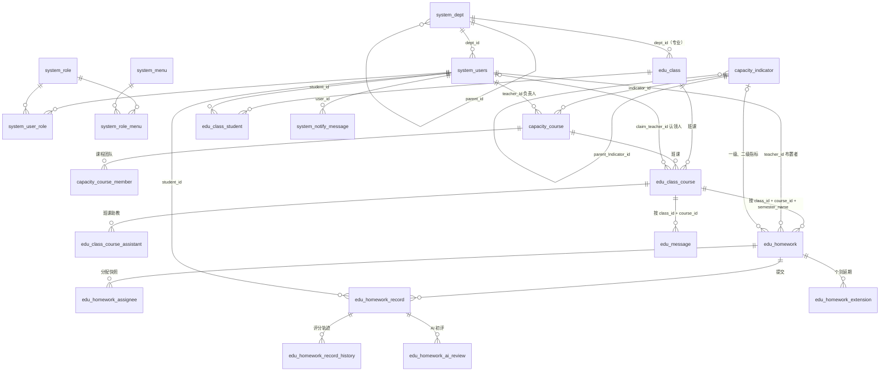

# 数据模型

- 面向：接手开发的同学和 AI 智能体
- 适用版本：V1.0.1.10（Flyway 版本 21）
- 最后核对日期：2026-10-14

表结构以数据库基线 `NUS-doc/3-数据库文件/ry261-test.sql`（文件头写有 `Flyway baseline version: 21`）加 `deploy/database/migrations/` 为准。本文只列核心业务表；脚手架自带的表（`QRTZ_*`、OAuth2、短信、邮件等）不展开。

> **`NUS-doc/2-架构设计图/主要业务ER图.drawio` 已过时**：它早于 V10–V21 共 12 个迁移，没有分配快照、认领、助教关联表、批改操作等。以本文和基线 SQL 为准，那份图只作历史参考。

## 1. 通用约定

- **每张表都有** `creator`、`create_time`、`updater`、`update_time`、`deleted`（逻辑删除，`bit(1)`）。下面的字段清单省略这几列。
- **逻辑删除**：MyBatis-Plus 的 Wrapper 查询自动加 `deleted = 0`；手写 SQL（XML、`@Select`、`inSql`）必须每张表自己写。
- **`updater` 有业务含义**：`edu_class_course` 上 `creator/updater = 'system'` 表示公共课同步自动建的关联，`'system-sync'` 表示被同步自动封存的。不要用 `updateById` 改这类行，见 [架构概览](架构概览.md) 第 4.2 节。
- **学期是字符串**：没有学期表。当前学期存在参数 `edu.current.semester.*`（`infra_config`），班课和任务各存一份 `semester_name`。两边匹配的口径是“任一方为空即匹配，否则两边 TRIM 后相等”。
- **接口名和状态不一一对应**：历史原因，`/edu/homework/delete`、`EduClassServiceImpl.deleteClass` 等名字带 delete 的接口，实际做的是**封存**（改 `status`）。真正删除任务的是 `/edu/homework/remove`。

## 2. 核心业务表

### 2.1 用户与组织

| 表 | 说明 | 关键字段与取值 |
| --- | --- | --- |
| `system_users` | 所有账号（管理员、教师、学生） | `username`（学号或工号）、`user_type`（字典 `system_user_type`：0 管理员、1 教师、2 学生）、`dept_id`（所属组织，数据权限按它过滤）、`status`（0 正常、1 停用）、`password_change_required`（1 表示首次登录必须改初始密码，V16） |
| `system_user_profile` | 用户扩展资料 | `user_id`、`grade_year`（入学年份）、`class_ids`（班级 ID 串，冗余，以 `edu_class_student` 为准）、`professional_title` |
| `system_dept` | 组织树：学校 → 学院 → 专业 | `parent_id`、`dept_code`（稳定编码，导入用）、`dept_type`（`SCHOOL`/`COLLEGE`/`MAJOR`）、`status` |
| `system_role` | 角色 | `code`（`super_admin`、`school_admin`、`college_admin`、`teacher`、`student`）、`data_scope`（1 全部、2 指定部门、3 本部门、4 本部门及以下、5 仅本人） |
| `system_user_role` | 用户和角色 | `user_id`、`role_id` |
| `system_menu` | 菜单、页面和按钮权限点 | `type`（1 目录、2 页面、3 按钮）、`permission`（如 `edu:homework:create`）、`parent_id`、`status` |
| `system_role_menu` | 角色拥有哪些菜单 | `role_id`、`menu_id` |

角色和权限点的用法见 [权限与数据范围](权限与数据范围.md)。

### 2.2 课程与指标（`capacity` 模块）

| 表 | 说明 | 关键字段与取值 |
| --- | --- | --- |
| `capacity_course` | 实训课程 | `course_name`；`teacher_Id`（**课程负责人**，注意列名大写 I）；`indicator_id`（课程对应的一级指标，任务的二级指标必须在它下面）；`is_public_course`（**0 公共课、1 专属课程**，列注释写反了，以 `CapacityCourseTypeConstants` 为准）；`public_audit_status`（0 无需审批、1 待审批、2 审批通过、3 审批驳回）；`status`（0 在用、1 已封存）；`teach_assistant_ids`（旧的团队成员 ID 串，仍同步写入但不再读取，以 `capacity_course_member` 为准） |
| `capacity_course_member` | 课程团队成员 | `course_id`、`user_id`、`role_type`（1 课程团队）。V18 从旧 ID 串回填 |
| `capacity_indicator` | 评价指标（能力指标）树，两级 | `indicator_name`、`indicator_level`（1 一级、2 二级）、`parent_Indicator_id`、`weight`（一级指标权重，能力综合分按它加权）、`status` |

“在线公共课” = `is_public_course = 0` 且 `public_audit_status = 2` 且 `status = 0`（`CapacityCourseRespDTO.isOnlinePublicCourse`）。

### 2.3 班级与班课

| 表 | 说明 | 关键字段与取值 |
| --- | --- | --- |
| `edu_class` | 班级，挂在专业下 | `class_name`、`grade_year`、`dept_id`（**数据权限按它过滤**）、`education_level`、`schooling_year`、`status`（0 在用、1 已封存） |
| `edu_class_student` | 班级里的学生 | `class_id`、`student_id`、`join_time`；唯一键 `(class_id, student_id)` |
| `edu_class_course` | **班课**：某班级在某学期上某门课 | `class_id`、`course_id`、`semester_name`、`semester_start_date`、`semester_end_date`；`status`（0 在用、1 已封存）；`backfill_pending`（公共课任务待补发）；`claim_teacher_id`、`claim_time`（公共课认领教师和时间，V21，未认领为空）；`assistant_teacher_ids`（旧助教 ID 串，V1.0.1.8 起停止使用，以下表为准）。唯一键 `(class_id, course_id, semester_name, deleted)` |
| `edu_class_course_assistant` | 班课助教 | `class_course_id`、`teacher_id`。V18 从旧 ID 串回填 |

### 2.4 实训任务与提交

| 表 | 说明 | 关键字段与取值 |
| --- | --- | --- |
| `edu_homework` | 实训任务。**一个任务只属于一个班级**，给多个班布置会生成多个任务 | `homework_name`；`course_id`、`class_id`、`semester_name`（三者对应一条班课，没有 `class_course_id` 列）；`homework_type`（1 平时任务、2 考核任务）；`homework_level`（1 初级、2 中级、3 高级）；`indicator_first_id`、`indicator_second_id`；`requirement`（任务内容，富文本）；`deadline`（只有旧草稿可为空）；`auto_grade`（0 仅人工批改、1 AI 初评 + 教师复核）；`ai_review_mode`（随 `auto_grade` 归一化，见 `HomeworkGradingMode`）；`submission_mode`（text/image/audio/video/mixed）；`score`（满分）、`pass_score`（及格线）；`teacher_id`（**布置者**，历史数据可能为 0）；`status`（见第 3 节）；`status_before_archive`（封存前状态，恢复用）；`source_homework_id`（复制或公共课补发的来源任务） |
| `edu_homework_assignee` | **分配快照**：任务发布时分给了哪些学生 | `homework_id`、`student_id`、`class_id`、`assigned_time`；唯一键 `(homework_id, student_id)`。学生可见、应交人数都以它为准 |
| `edu_homework_record` | 学生的提交（每人每任务一条） | `content`、`attachment_urls`、`submit_time`、`score`、`comment`、`correct_time`、`correct_type`（1 手动、2 AI，见 DO 注释）、`status`（0 未提交、1 待批改、2 已批改、3 已打回、4 已重新提交）、`redo_count`、`redo_deadline`（重做截止时间）。唯一键 `(homework_id, student_id, deleted)`；`update_time` 为毫秒精度，用于防并发覆盖 |
| `edu_homework_record_history` | 评分轨迹：提交、重交、批改、打回、调整重做期限、撤销 | `record_id`、`event_type`（代码中有 `SUBMIT`、`RESUBMIT`、`CORRECT`、`REDO`、`REDO_DEADLINE`、`UNDO`）、`from_status`、`to_status`、`score`、`comment`、`operator_id` |
| `edu_homework_grading_action` | 批改、打回的操作快照，用于撤销和延时通知 | `action_type`（`CORRECT`/`REDO`）、`prev_*`（操作前的状态、分数、评语等）、`undo_deadline`、`notify_status`（0 待发送、1 已发送、2 已撤销、3 发送失败） |
| `edu_homework_extension` | 个别延期 | `homework_id`、`student_id`、`deadline`（个人截止时间）、`reason`、`operator_id` |
| `edu_homework_remind_log` | 截止前提醒的去重记录 | `homework_id`、`student_id`、`remind_type`（`AUTO`） |
| `edu_homework_notify_state` | 每个任务的催交与教师汇总进度 | `manual_remind_time`、`digest_until`、`digest_notify_time` |
| `edu_homework_digest_scan` | 教师新提交汇总的全局扫描边界（只有 id=1 一行） | `scan_until` |
| `edu_question_bank` | 题库 | `title`、`requirement`、`indicator_first_id`、`indicator_second_id`、`homework_level`、`teacher_id` |
| `edu_course_resource` | 课程资源文件 | `course_id`、`resource_name`、`file_url`、`file_type`、`file_size` |
| `edu_homework_ai_create_preview` | AI 新建任务的预览会话 | 待确认（未逐列核对） |

### 2.5 AI 初评

| 表 | 说明 | 关键字段与取值 |
| --- | --- | --- |
| `edu_homework_ai_review` | 单份提交的 AI 初评草案，一份提交可以有多条，取最新一条 | `homework_record_id`、`homework_id`、`student_id`；`status`（0 排队中、1 处理中、2 已生成、3 失败、4 已采纳、5 已拒绝、6 已跳过）；`generation_token`（防止旧结果覆盖新结果）；`source_submit_time`（依据哪次提交）；`ai_score`、`ai_comment`、`ai_confidence`；`teacher_decision`（accept/adjust/reject）、`teacher_score`；`error_message` |
| `ai_edu_review_task` | 教师发起的批量初评任务 | `homework_id`、`teacher_id`、`total_count`、`success_count`、`fail_count`、`status`（0 处理中、1 完成、2 部分失败）、`generation_token` |
| `ai_edu_feedback` | 教师对 AI 评分的反馈，用于校准 | `homework_record_id`、`feedback_type`（strict/normal/loose）、`original_score` |
| `ai_prompt_template` | 提示词版本，启用一个版本 | 待确认（未逐列核对） |
| `ai_call_log` | 每次调用模型一条：业务、模型、发起人、令牌数、耗时、是否成功，默认保留 180 天 | 待确认（未逐列核对） |
| `ai_model`、`ai_api_key`、`ai_business_model_binding` | 模型、密钥、业务用哪个模型 | 脚手架表，按需查看 |

### 2.6 统计相关

**没有统计结果表**。合格率、趋势、看板等都是查询时从 `edu_homework`、`edu_homework_assignee`、`edu_homework_record` 实时计算的（`StatisticsMapper.xml`、`EduStatisticsServiceImpl`、`EduMetricPolicy`）。为此 V20 给状态类字段建了索引和直方图。

| 表 | 说明 | 关键字段与取值 |
| --- | --- | --- |
| `edu_student_level_unlock` | 等级解锁快照：解锁后不再回锁 | `student_id`、`course_id`、`level`（2 中级、3 高级）、`unlocked_at`、`ratio_at_unlock` |
| `infra_config` | 统计口径参数也在这里 | 例如 `edu.pass.score`（默认及格线）、`edu.course.unlock-ratio`（解锁比例，默认 0.8）、`edu.score.good-ratio`、`edu.score.excellent-ratio`、`edu.certificate.threshold` |

**遗留表，代码已不读写**（2026-10-14 在后端、前端、迁移中检索确认）：`edu_course_progress`、`edu_student_ranking`、`edu_homework_draft`、`ai_edu_review_log`。不要往里写新逻辑。

### 2.7 留言与通知

| 表 | 说明 | 关键字段与取值 |
| --- | --- | --- |
| `edu_message` | 留言：学生和教师围绕某班某课的问答 | `class_id`、`course_id`、`student_id`（一串留言按这三者归组）、`content`、`type`（0 学生留言、1 教师回复）、`status`（0 开启、1 关闭）、`read_status`（接收方 0 未读、1 已读）、`read_time` |
| `system_notify_template` | 通知模板 | `code`（如 `edu.student.homework.created`，常量见 `EduBusinessNotifyService`）、`content`（含 `{参数}` 占位）、`params` |
| `system_notify_message` | 发给每个人的通知（铃铛） | `user_id`、`template_code`、`template_content`（发送时已渲染）、`template_params`、`read_status`、`read_time` |

### 2.8 导入

| 表 | 说明 | 关键字段与取值 |
| --- | --- | --- |
| `edu_import_batch` | 一次导入 | `batch_no`、`biz_type`、`template_version`、`status`（`PREVIEW_READY`、`PREVIEW_INVALID`、`CONFIRMING`、`SUCCESS`、`FAILED`、`CANCELLED`）、各类计数、`expire_time`（预检过期）、`failure_reason` |
| `edu_import_batch_item` | 预检后的每一行（规范化快照） | 确认导入时只写这里的数据 |

## 3. 状态口径

### 3.1 实训任务 `edu_homework.status`

| 值 | 界面叫法 | 含义 |
| --- | --- | --- |
| 0 | 待发布 | 旧版“复制为草稿”留下的任务。V1.0.1.10 起**不再新建**；老师编辑保存时自动发布（截止时间必填） |
| 1 | 已发布 | 学生可见、可提交 |
| 2 | 已截止 | 字典和前端保留此值，**后端不写入**。是否截止一律按 `deadline`（含个别延期）判断 |
| 3 | 已封存 | 只读，不能编辑、批改，学生待办里不出现；可以恢复（恢复到 `status_before_archive`） |

常量：后端 `EduHomeworkStatusEnum`，前端 `utils/status.ts` 的 `HOMEWORK_STATUS`。

### 3.2 班级、课程、班课

`edu_class.status`、`capacity_course.status`、`edu_class_course.status`：**0 在用，1 已封存**。表注释里有的写“停用”，含义就是封存。

### 3.3 封存与删除对统计的影响

| 统计 | 已封存的任务、班级、课程、班课 | 已删除的（`deleted = 1`） |
| --- | --- | --- |
| 看板总数（学生、教师、课程、任务） | 不计，只算在用 | 不计 |
| 待办类（待批改、本周提交、最近任务） | 不计 | 不计 |
| 分析类（合格率、成绩趋势、课程分析、学生排名、AI 班级分析） | **计入** | 不计 |
| 单个任务统计、班课详情的成绩分析 | 计入 | 不计 |
| 学生能力画像、实训报告、往期任务 | 提交过的计入 | 不计 |
| 学期收尾预览 | 只看在用的 | 不计 |

- 分析类不计“待发布”（状态 0），看板类只算状态 1、2。对应 SQL 片段：`StatisticsMapper.xml` 的 `visibleHomeworkScope`（看板，在用）和 `analysisHomeworkScope`（分析，含封存）。
- **删除只针对实训任务**：逻辑删除任务，同一事务里删除它的分配、提交、轨迹、批改操作、AI 初评、延期和提醒（`EduHomeworkRemoveService`）。班级、课程、班课没有删除，只有封存。
- 理由见 [ADR-002](决策记录/ADR-002-封存与删除的统计口径.md)。

## 4. 主要关系

说明：

- 表之间**没有外键约束**，关系靠代码维护。
- `edu_homework` 不直接存班课 ID，靠 `(class_id, course_id, semester_name)` 对上 `edu_class_course`。V1.0.1.10 起新建接口可选传 `classCourseId`，后端核对三者一致。
- 学生看到哪些任务：`edu_homework_assignee` 里有自己，且任务已发布、班级、课程、班课都在用（`EduHomeworkArchiveAccessService`）；封存后仍可只读查看自己做过的任务。

## 5. 改表结构时

- 新迁移、同步基线、写 check 脚本，见 [数据库迁移](../03-开发/数据库迁移.md)。已发布的迁移（V1–V21）不能改。
- 新加要过滤的状态类字段，在迁移里建直方图，参考 V20。
- 改了状态或统计口径，对照上面 3.3 节，检查学生端、看板、分析三处是否一致。
