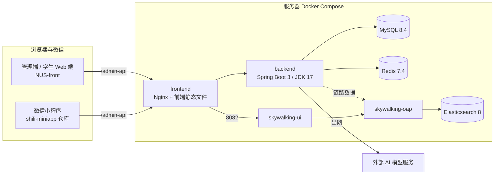

# 架构概览

- 面向：接手开发的同学和 AI 智能体
- 适用版本：V1.0.1.10（数据库迁移 V21）
- 最后核对日期：2026-10-14

本文讲系统由哪些部分组成、一次请求怎么走、几个关键机制在哪个类里。表结构见 [数据模型](数据模型.md)，权限规则见 [权限与数据范围](权限与数据范围.md)，设计取舍见 [决策记录](决策记录/README.md)。

## 1. 系统组成



| 组成 | 说明 | 代码或配置位置 |
| --- | --- | --- |
| 前端 | 管理端和学生 Web 端是同一个应用，按角色显示不同导航。Vue 3 + vben5 + ant-design-vue 4。菜单和路由来自后端（`preferences.ts` 里 `accessMode: 'backend'`） | `NUS-front/apps/web-antd/src/` |
| 后端 | 单体应用，Maven 多模块，所有接口前缀 `/admin-api`（`WebProperties`）。业务端口 48080，管理端口 48081（健康检查） | `NUS-backend/`，主类 `NusServerApplication` |
| MySQL | 业务数据。首次安装导入基线 `ry261-test.sql`，之后用 Flyway 执行 `V*.sql` | `deploy/database/` |
| Redis | 登录令牌、Spring 缓存、防重复提交的键 | `nus-spring-boot-starter-redis` |
| Elasticsearch | **只给 SkyWalking 存链路数据**，业务不用 | `deploy/compose.yaml` 的 `SW_STORAGE: elasticsearch` |
| SkyWalking | 后端带 Java Agent 上报链路；界面通过前端容器的 8082 端口访问 | `deploy/compose.yaml` |
| 小程序 | 只调用本仓库后端的接口，登录走 `/system/wechat-mini-program/*` | 另一个仓库 `shili-miniapp` |

**部署形态**：学校服务器不联网。用离线安装包首次安装，用升级包升级，全部服务跑在一台 Ubuntu 上的 Docker Compose 里，数据放在 `/srv/nus`。MySQL、Redis、ES、后端都只在内部网络，宿主机只暴露前端的 HTTP 端口和 8082。安装、升级、回滚见 [运维手册](../04-运维/运维手册.md)，理由见 [ADR-006](决策记录/ADR-006-离线部署与升级回滚.md)。

## 2. 后端模块

包名前缀都是 `cn.nus.zknu`。

| 模块 | 内容 |
| --- | --- |
| `nus-framework` | 脚手架能力，每个是一个 starter：`web`、`security`、`mybatis`、`redis`、`biz-data-permission`（数据权限）、`protection`（防重复提交、限流）、`excel`、`job`（定时任务）、`monitor`、`test` |
| `nus-module-infra` | 参数配置、文件存储、定时任务、接口日志 |
| `nus-module-system` | 用户、组织、角色、菜单、字典、通知（站内信）、登录 |
| `nus-module-ai` | AI 模型、提示词、调用日志、额度与熔断，对外提供 `AiEduReviewApi` |
| `nus-module-capacity` | 课程（含公共课审批）、能力指标，对外提供 `CapacityCourseApi`、`CapacityIndicatorApi` |
| `nus-module-edu` | 核心教学：班级、班课、学期、实训任务、批改、AI 初评、统计、留言、导入导出、学生端 |
| `nus-server` | 启动模块，把上面全部装起来；权限快照测试 `EndpointPermissionsSnapshotTest` 在这里 |

**依赖方向**（只能从左往右依赖）：

```text
nus-framework  ←  infra  ←  system  ←  ai、capacity  ←  edu  ←  nus-server
```

- `edu` 依赖 `system`、`capacity`、`ai`。
- `edu` **只能经过 `capacity`、`ai` 的 `api` 包**（接口和 DTO）访问这两个模块，不能注入它们的 Mapper、DO、Service。由 `EduModuleBoundaryArchTest`（ArchUnit）检查。
  - 例外：MyBatis XML 里可以只读联表 `capacity_course`，这不在 ArchUnit 检查范围内。
- `edu` 对 `system` 没有这条限制，可以直接用 `system` 的服务（例如 `EduDeptScopeService` 用了 `DeptService`）。新代码优先用 `system.api` 下的接口。

## 3. 一次请求的链路

以教师在课程详情里“新建任务”为例：

```text
浏览器
 └─ api/request.ts：带登录令牌；写操作自动加 X-Idempotency-Key
     └─ frontend 容器 Nginx：/admin-api 转发到 backend:48080
         └─ TokenAuthenticationFilter：用令牌找到登录用户
             └─ PasswordChangeRequiredInterceptor：需改初始密码的账号只放行改密相关接口
                 └─ Controller 方法
                     ├─ @PreAuthorize("@ss.hasPermission('edu:homework:create')")：功能权限（菜单按钮）
                     ├─ @Idempotent：同一幂等键 2 分钟内只执行一次
                     └─ Service
                         ├─ EduDataScopeService / EduAiBusinessAccessService：业务范围（课程、班级、认领）
                         ├─ Mapper → MyBatis-Plus 拦截器链
                         │    └─ DataPermissionInterceptor：给 edu_class、system_users、system_dept 追加院系条件
                         ├─ Redis 缓存（@Cacheable）与请求内缓存（EduRequestCache）
                         └─ 事务提交后：发通知、派发 AI 初评、公共课补发
```

要点：

- **两层权限缺一不可**：`@PreAuthorize` 只判断“有没有这个按钮”，不知道“这门课是不是你的”。后者必须在 Service 里调用 `EduDataScopeService` 等判断。V1.0.1.8 修过一处只查了菜单权限的漏洞。
- `@ss` 是 `SecurityFrameworkServiceImpl`（在 `NusSecurityAutoConfiguration` 里注册为 `ss`）。超级管理员拥有全部权限。
- 学生端接口也在 `controller/admin/` 下（如 `AppStudentHomeworkController`），同样走 `/admin-api`。
- 统一错误：业务异常用 `ServiceExceptionUtil.exception(错误码)`，由 `GlobalExceptionHandler` 转成 `CommonResult`。

## 4. 关键机制

### 4.1 数据权限（院系范围）

- **在哪**：
  - 框架：`nus-spring-boot-starter-biz-data-permission` 的 `DeptDataPermissionRule`、`DataPermissionRuleHandler`，由 `NusDataPermissionAutoConfiguration` 挂到 MyBatis-Plus 的 `DataPermissionInterceptor` 上。
  - 规则登记：`system` 模块 `DataPermissionConfiguration`（`system_users.dept_id`、`system_dept.id`，以及“仅本人”时的 `system_users.id`）；`edu` 模块 `DataPermissionConfiguration`（`edu_class.dept_id`）。
  - 写入校验：`system` 的 `UserDeptScopeService`，`edu` 的 `EduDeptScopeService`。
- **怎么工作**：
  1. 登录用户的角色有 `data_scope`（1 全部、2 指定部门、3 本部门、4 本部门及以下、5 仅本人）。规则按角色算出可见部门，缓存在登录用户上下文里。
  2. 每条 SQL 执行前，拦截器用 JSqlParser 解析，凡是出现上面三张表（含子查询、派生表），就追加 `dept_id IN (...)` 之类的条件。
  3. 写操作（新建、导入）不经过拦截器，靠 `validateDeptInScope` 等方法显式校验，导入时把外院的行标成“不在本学院”。
- **目前谁受限**：只有学院教务管理员（`data_scope=4`）。教师、学校教务管理员、学生都是“全部”，详见 [权限与数据范围](权限与数据范围.md)。
- **改的时候注意**：
  - 手写 SQL 涉及这三张表时，要用 H2（MySQL 模式）走真实拦截器链测一遍，参考 `EduClassDataPermissionSqlTest`、`EduImportBatchLookupSqlTest`。
  - **已知例外**：JOIN 的 ON 条件里嵌套的 EXISTS 不会被改写。这也是学院管理员的课程、任务、统计还没按学院过滤的原因（V1.0.1.8 已知限制）。
  - 需要绕过时用 `DataPermissionUtils.executeIgnore(...)`，并在注释里写明为什么。

### 4.2 公共课认领与数据范围（`EduDataScopeService`）

- **在哪**：`edu/service/dataexchange/EduDataScopeService.java`。认领、放弃接口在 `EduClassCourseServiceImpl`（`/edu/class-course/claim-options`、`claim`、`release`）。
- **怎么工作**：
  - 判断是否公共课：`isPublicCourse`。注意 `capacity_course.is_public_course` **取 0 表示公共课**（`CapacityCourseTypeConstants.PUBLIC_COURSE = 0`），字段注释写反了，以代码为准。
  - 认领写在 `edu_class_course.claim_teacher_id`、`claim_time` 上。同一班级、课程、学期一行。
  - 判断方法：
    - `canViewAllPublic`：管理员、公共课审批人、课程负责人，只读看全部；
    - `isClaimedByCurrentUser`、`claimedClassIds`：当前用户认领了哪些班；
    - `canAssignToPublicClass`：能否布置任务，只有认领人和管理员；
    - `canViewPublicClass`：能否查看班级（详情、名单、留言、统计）；
    - `validateClassCourseAccess`：留言等按班课授权。
  - 任务本身按布置者授权（`EduAiBusinessAccessService.requireHomeworkAccess`），放弃认领后布置者仍能查看、批改自己的任务。
- **改的时候注意**：
  - 公共课的权限判断一律调这些方法，不要另写。
  - 认领字段只能用条件 UPDATE 写（`... WHERE claim_teacher_id IS NULL` 并检查影响行数），**不要 `updateById`**：公共课同步靠 `updater='system'` 判断“自动建的关联”，`updateById` 会改掉 `updater`。
  - 认领、同步、补发共用一把课程锁（`lockPublicCourse`），新增写入路径也要取这把锁。
  - 每个方法内部用 `EduRequestCache` 缓存课程、成员查询，一个请求里多次调用不会重复查库。

### 4.3 任务分配快照（`edu_homework_assignee`）

- **在哪**：
  - 发布时生成：`EduHomeworkPublishService.snapshotAssigneesIfPublished`；
  - 学生进出班同步：`EduClassStudentServiceImpl.syncAssigneesForMembershipChange`；
  - 用户管理改班：`system` 发出 `StudentClassesChangedEvent`，`EduStudentClassesChangedListener` 接收后调用上面的方法。
- **怎么工作**：
  - 任务发布时，把班里当时的学生逐个写进 `edu_homework_assignee`。学生能不能看到任务、“应交人数”是多少，都看这张表，**不看班里现在有谁**。
  - 学生进班：给班里已发布、未截止的任务补分配（之前移除过的恢复），并发“加入班级”通知。
  - 学生出班：移除未截止任务里**没有任何提交记录**的分配；有记录的保留，成绩不丢。
  - 公共课补发也按新班级学生生成快照（`EduPublicCourseBackfillService`）。
- **改的时候注意**：
  - 新增任何“让学生进出班”的入口，都必须走 `EduClassStudentService`，否则学生看不到已布置的任务。V1.0.1.10 修的就是用户管理入口漏了这一步。
  - 统计“应交、已交”要 JOIN 分配表，只算仍在分配表里的学生（V1.0.1.9 计划 C1）。
  - 理由见 [ADR-001](决策记录/ADR-001-任务按发布时学生快照分配.md)。

### 4.4 AI 初评的排队与执行

- **在哪**：
  - 入队：`EduHomeworkAiReviewServiceImpl.enqueuePreReview`、`triggerPreReviewAsync`；
  - 派发：`HomeworkAiReviewDispatcher`（发件箱模式）；
  - 线程池：`EduAiReviewExecutorConfiguration`（Bean 名 `eduAiReviewTaskExecutor`，大小来自 `nus.edu.ai-review.*`）；
  - 批量初评的恢复：`AiReviewTaskRecoverer`；
  - 调用模型：`ai` 模块 `AiEduReviewApiImpl`。`AiModelService#getChatModel` 返回的模型都经过 `AiCallGovernor`：调用前查熔断（`AiCircuitBreaker`）和额度（`AiQuotaChecker`），调用后写 `ai_call_log`。系统提示词从 `AiPromptTemplateService` 读当前启用版本（表 `ai_prompt_template`）；
  - 校准：`AiReviewCalibrationService`，用教师对 AI 评分的反馈（`ai_edu_feedback`）和分差调整后续提示。
- **怎么工作**：
  1. 学生提交或重交时，在**同一事务**里写一条 `edu_homework_ai_review`，状态 0“排队中”。
  2. 事务提交后（`dispatchAfterCommit`）才交给线程池。线程池满了也不丢，记录保持排队中。
  3. 执行前用条件更新“0 → 1 处理中”认领，多实例或重复派发只有一个成功。
  4. 定时扫描（间隔 `edu.ai-review.dispatch-interval-seconds`，默认 15 秒）派发排队记录，并把排队或处理过久的判为失败（3），通知布置教师（同一任务 6 小时最多一条）。
  5. 服务启动时，把上次运行遗留的“处理中”放回排队（`edu.ai-review.requeue-on-startup`）。
  6. 生成后状态 2，教师在批改页采纳（4）、拒绝（5）；被新提交取代等情况为跳过（6）。**AI 只给草案，教师确认后才是成绩。**
- **改的时候注意**：
  - 多台后端同时运行时，`edu.ai-review.requeue-on-startup` 要改为 false，否则会互相把对方正在处理的记录放回排队。
  - 发送给模型的学生内容受环境变量 `NUS_AI_EXTERNAL_STUDENT_DATA_ENABLED` 控制。
  - 依赖服务器上的 ffmpeg、vosk 做音视频转写（离线包内置）。

### 4.5 通知与站内信

- **在哪**：
  - 教学业务统一入口：`EduBusinessNotifyService`，模板编码常量都在这个类里（如 `edu.student.homework.created`）；
  - 底层：`system` 的 `NotifyMessageSendApi`，`sendBatchMessageToAdmin` 每 500 人一批写 `system_notify_message`；
  - 批改、打回的延时通知：`EduHomeworkGradingActionService` + `EduGradingNotifySender`；
  - 任务变更通知：`EduHomeworkChangeNotifier`（只有截止时间、内容、附件要求、提交方式、满分、及格线变化才通知）；
  - 留言接收人：`EduMessageRecipientResolver`；打开留言时同步标记通知已读：`EduMessageNotifyReadService`。
- **怎么工作**：
  - 通知只是写库，没有推送。前端每 30 秒左右轮询未读数，标记已读后调用 `emitNotifyUnreadChanged()` 立即刷新铃铛（`utils/notify-unread.ts`）。
  - 发送失败只记日志，**不让业务操作失败**。
  - 批改、打回后，通知先存进 `edu_homework_grading_action`（`notify_status=0`），撤销期（`edu.grading.undo-seconds`，默认 10 秒）过后才发；撤销则不发。
  - 定时类通知：截止前提醒 `EduHomeworkRemindJob`（每小时）、教师新提交汇总 `EduHomeworkTeacherDigestJob`（每 10 分钟检查）。
- **改的时候注意**：
  - “通知”与“留言”是两回事：通知是系统提醒（铃铛），留言是师生问答（`edu_message`）。界面叫法见 [术语表](../01-产品/术语表.md)。
  - 新模板要在迁移里插入 `system_notify_template`；改出厂模板时只改仍是默认内容的行，学校改过的不动。
  - 通知模板有 Redis 缓存（`notify_template`），升级脚本会清除。
  - 已发出的通知不会因任务删除而撤回（V1.0.1.10 已知限制）。

### 4.6 学期与学期收尾

- **在哪**：
  - 当前学期：`EduSemesterServiceImpl`。**没有学期表**，当前学期存在参数 `edu.current.semester.name`、`start-date`、`end-date`、`auto-enabled` 里；
  - 可选学期：`EduSemesterOptionService`（当前学期 + 班课里用过的学期名）；
  - 自动切换：定时任务 `EduSemesterAutoUpdateJob`（每天 0:05），启动时 `EduSemesterStartupSynchronizer`；
  - 学期收尾：`EduSemesterWrapUpService`（`preview`、`archive`）；
  - 公共课同步：`EduPublicCourseSyncService`，由学期切换、定时任务 `EduPublicCourseSyncJob`（每天 0:15）触发。
- **怎么工作**：
  - 班课、任务上都存学期**名称字符串**（`semester_name`）。匹配口径：**任一方为空即匹配，否则两边 TRIM 后相等**。
  - 切换当前学期后，公共课在后台给新学期的正常班级建关联（`creator/updater='system'`），并把旧学期由同步创建、已空闲、未认领的关联自动封存。
  - 学期收尾：预览某学期还在用的班课、进行中的任务、待批改的提交 → 勾选 → 批量封存班课，以及只在该学期有课的班级。封存可恢复。判断“只在该学期有课”时，忽略系统同步建的、未认领的公共课关联。
- **改的时候注意**：
  - 学期匹配谓词不要简化成等值比较，历史数据里有空串和带空格的学期名（V1.0.1.9 计划 C6）。
  - 当前学期有 10 分钟缓存。在界面里改会立即清缓存；直接改库要等过期。

### 4.7 导入导出框架

- **在哪**：
  - 导入接口：`EduImportBatchController`（`/edu/import-batch/*`）、`EduDataExchangeController`；
  - 通用流程：`EduImportBatchServiceImpl`；
  - 每种业务一个处理器，实现 `EduImportHandler`：组织、学生档案、教师档案、系统用户、班级花名册、成绩册、题库（`*DataExchangeHandler`）；
  - 模板：`EduDataExchangeTemplateService`；后台线程池 `EduImportExecutorConfiguration`（Bean 名 `eduImportExecutor`）；
  - 导出：各 `*DataExchangeController` 的 `/export` 接口，工作簿工具 `EduXlsxWorkbookUtils`。
- **怎么工作**：
  1. **预检**：上传文件，处理器 `preview` 逐行校验，结果存进 `edu_import_batch`、`edu_import_batch_item`，状态 `PREVIEW_READY` 或 `PREVIEW_INVALID`。预检有过期时间。
  2. **确认**：状态改为 `CONFIRMING`，在后台线程里调用处理器 `commit`，只写预检时保存的规范化行快照。整批一个事务，失败不会只导入一半。
  3. 前端轮询批次状态，显示进度；用户可以关掉窗口，导入继续。
  4. 服务重启时，还在 `CONFIRMING` 的批次直接标为失败（`run` 方法），提示重新上传。
- **改的时候注意**：
  - 新增一种导入：写一个 `EduImportHandler` 的实现（Spring 自动收集），实现 `validatePermission`，按需加模板版本。不要另写一套上传接口。
  - 成绩册导入有防误改规则：分数、评语都没变的行跳过；预检后记录有变化时整批拒绝（V1.0.1.7）。
  - 日志里不能记录初始密码。
  - 已知限制：账号导入仍逐行创建，几千人要几分钟；导出一次读出全部数据。

### 4.8 缓存

- **在哪**：
  - Redis 缓存管理器：`TimeoutRedisCacheManager`，支持 `@Cacheable(cacheNames = "名字#过期时间")`；
  - 缓存名常量：各模块的 `RedisKeyConstants`（如 `edu_current_semester#10m`、`infra_config_by_key#60s`、`capacity_indicator_tree#1h`、`system_dict_data#1h`，以及权限相关的 `permission_menu_ids`、`user_role_ids` 等）；
  - 请求内缓存：`EduRequestCache`（edu）、`UserDeptScopeRequestCache`（system）。
- **怎么工作**：
  - 参数、当前学期、学期选项、能力指标树、字典、角色和菜单权限、通知模板放 Redis，界面上修改时 `@CacheEvict` 清除。
  - 课程信息、课程成员、审批人判断等权限相关数据**只做请求内缓存**，请求结束即失效。这样刚被移出团队的人不会因缓存继续有权限。没有请求上下文的后台线程直接查库。
  - 看板**不缓存**，保持实时（V1.0.1.9 用户决定）。
- **改的时候注意**：
  - 改数据的地方都要清对应缓存。
  - 新增缓存类别时，同步修改 `deploy/offline/lib/common.sh` 的 `clear_permission_caches`、`clear_restored_db_caches`，否则升级或恢复备份后会读到旧值。
  - 直接改数据库后，最长要等到缓存过期才生效。

### 4.9 防重复提交

- **在哪**：
  - 后端：`@Idempotent`（`nus-spring-boot-starter-protection`），切面 `IdempotentAspect`，键存 Redis（`IdempotentRedisDAO`）；
  - 业务接口统一用 `keyResolver = RequestHeaderIdempotentKeyResolver.class`，读请求头 `X-Idempotency-Key`；
  - 前端：`api/request.ts` 给所有写请求（POST、PUT、DELETE 等）自动加这个请求头。
- **怎么工作**：
  - 前端按“方法 + 地址 + 参数”算指纹，同一指纹 2 分钟内复用同一个幂等键。成功或业务失败后清掉；网络错误、超时则保留，用户重试时后端能识别为同一次提交。
  - 后端用“方法 + 幂等键 + 用户”作键，在 `timeout`（常用 2 分钟）内重复的请求直接返回 `message` 里的提示。
  - 另有数据库层的兜底：提交记录唯一键 `uk_hw_stu`；批改、打回、重交都是条件更新，两位教师同时批改时后保存的一方会看到“这份提交已被他人更新”（V1.0.1.7）。
- **改的时候注意**：
  - 会产生数据的新接口都加 `@Idempotent`，并写清楚 `message`。
  - 用 `RequestHeaderIdempotentKeyResolver` 的接口，如果不经过前端 `request.ts`（例如脚本、小程序）调用，必须自己带请求头，否则报“请求缺少幂等标识”。

## 5. 定时任务

两类，别混：

| 类型 | 在哪配置 | 例子 |
| --- | --- | --- |
| 任务中心（Quartz，存 `infra_job`，可在“定时任务”页面停用） | 迁移里插入 `infra_job`，处理器实现 `JobHandler` | `eduPublicCourseSyncJob`、`eduSemesterAutoUpdateJob`、`eduHomeworkRemindJob`、`eduHomeworkTeacherDigestJob`、`eduNewsCrawlerJob`、`aiCallLogCleanJob`、日志清理三项 |
| Spring 定时（代码里，秒级） | `SchedulingConfigurer` 或 `@Scheduled` | `HomeworkAiReviewDispatcher` 扫描、`EduGradingNotifySender` 发延时通知、`AiReviewTaskRecoverer` |

## 6. 前端结构

| 位置 | 内容 |
| --- | --- |
| `src/views/` | 页面。`edu/` 教学业务，`capacity/` 课程与指标，`edu/student/` 学生端，`system/`、`infra/`、`ai/` 管理端 |
| `src/api/` | 接口定义，按后端模块分目录；`request.ts` 是请求客户端（令牌、刷新、幂等键、错误提示去重） |
| `src/components/` | 公共组件。用户填写的富文本一律用 `rich-html` 显示 |
| `src/utils/status*.ts` | 状态文字与颜色的唯一来源 |
| `src/adapter/vxe-table.ts` | 表格适配，删除后页码回退在这里统一处理 |
| `tests/copy/` | 界面文案扫描 |

前端的坑和检查清单见 `NUS-front/AGENTS.md`。

## 7. 相关文档

- [数据模型](数据模型.md)、[权限与数据范围](权限与数据范围.md)、[决策记录](决策记录/README.md)
- [编码规范](../03-开发/编码规范.md)、[数据库迁移](../03-开发/数据库迁移.md)、[测试指南](../03-开发/测试指南.md)
- [运维手册](../04-运维/运维手册.md)、[故障排查](../04-运维/故障排查.md)
